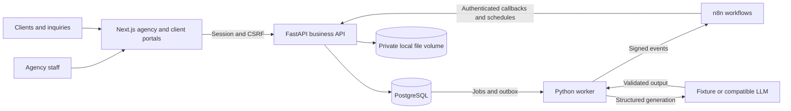

# CREATIVE OS

**AI-Assisted Agency Operations & Workflow Automation Platform**

CREATIVE OS is a full-stack portfolio MVP that brings together **client acquisition, creative briefs, AI-assisted content production, project and task management, approvals, reporting, and workflow automation** in one platform. It is designed to demonstrate how fragmented agency operations can become more traceable, measurable, and easier to coordinate.

> **Status:** Local portfolio MVP using synthetic data. Not production-ready. A manually confirmed file-access authorization issue remains open; do not deploy publicly or use real confidential client files. See [Known limitations](#known-limitations-and-roadmap).


## Business problem and solution

Creative agencies frequently manage inquiries, briefs, tasks, revision requests, approvals, and progress reporting across disconnected systems. That makes it difficult to answer which brief was approved, who owns the next task, what is overdue, which content revision a client signed off, and whether an automated notification was delivered.

CREATIVE OS connects these records through two role-based workspaces:

- **Agency workspace:** Lead qualification, project creation, team assignment, AI-assisted creative work, Kanban, milestones, operational dashboards, workflow monitoring, and report publication.
- **Client portal:** Brief submission, released deliverable review, revision requests and approvals, shared project progress, and published reporting.

## Core deliverables

| Domain | Implemented capabilities | Operational purpose |
|---|---|---|
| Client acquisition | Public inquiry, lead qualification, client/project conversion, single-use invitations | Connect leads to active projects |
| Brief management | Versioned briefs, attachments, agency review, immutable approved snapshots | Preserve requirements and approval history |
| AI-assisted production | Brief analysis, creative strategy, content planning, copy suggestions, schema validation, human selection | Accelerate drafting while retaining human decisions |
| Project management | Project membership, task creation and assignment, task templates, milestones, editable project planning and activity timeline | Organize work and its history |
| Task operations | Kanban and table views, status/priority/assignee filters, due dates, overdue identification | Monitor delivery and workload |
| Operational dashboards | Agency KPIs, workload and overdue monitoring; client-safe project progress and shared milestones | Make progress visible to appropriate roles |
| Client approvals | Exact-revision release, feedback, revision requests, project-scoped sign-off | Track which deliverable version was approved |
| Workflow automation | Background worker, durable event outbox, n8n orchestration, task notifications, scheduled deadline reminders, retry/deduplication | Reduce manual follow-up and support execution tracing |
| Reporting | Database-derived project metrics, AI-assisted draft summaries, review, publication, JSON export | Ground client reports in recorded data |
| Evaluation and QA | Synthetic AI evaluations, schema/grounding checks, targeted tests, browser journeys, manual UAT | Document behavior and known limitations |

**Scope note:** Sprint 1–3 features were manually checked in a local development environment. They should not be represented as having passed the historical CP6 full regression suite without a fresh run.

## Demo: one connected business workflow

1. A prospect submits an inquiry; an Agency Manager qualifies the lead, creates a project, and invites the client.
2. The client submits a creative brief; the manager reviews and approves a specific version.
3. The AI-assisted Creative Studio produces structured analysis, strategy, planning, and copy suggestions. Staff choose a direction and edit content.
4. A manager plans milestones, assigns project members and individual tasks, and tracks delivery on the Kanban board and agency dashboard.
5. Task assignment and deadline events generate notifications through the local workflow automation stack.
6. The agency releases an exact content revision. The client reviews it, requests changes if needed, or approves it.
7. An authorized agency user publishes a project report using stored performance metrics; the client sees the published result.

See the [reproducible portfolio walkthrough](docs/PORTFOLIO_DEMO.md) and its screenshot gallery. The walkthrough documents the earlier CP6 baseline; newer Sprint 1–3 screens are covered by their respective implementation notes below.

| Agency release confirmation | Published client report |
|---|---|
|  |  |

## Architecture



| Layer | Stack | Responsibility |
|---|---|---|
| Frontend | Next.js 16, React 19, TypeScript, Tailwind CSS | Role-based workspaces, Kanban, dashboards and reviews |
| API | Python 3.12, FastAPI, Pydantic, SQLAlchemy | Authentication, authorization, validation and business rules |
| Storage | PostgreSQL 16, Alembic, private local file volume | State, audit history, immutable versions and outbox events |
| Automation | Python background worker, n8n 2.48.6 | Async processing, schedules, notifications and retry handling |
| AI | Fixture provider; compatible HTTPS LLM adapter | Structured generation, validation and provenance |
| Quality | Pytest, Vitest, Playwright, Docker Compose | Testable services and local end-to-end flows |

**Architecture principle:** FastAPI owns business decisions and permission checks. PostgreSQL records authoritative state. n8n handles orchestration, while AI produces suggestions that require human review before consequential publication or approval.

Further reading: [database design](docs/03_DATABASE_DESIGN.md) · [API specification](docs/04_API_SPECIFICATION.md) · [AI system design](docs/05_AI_SYSTEM_DESIGN.md) · [workflow automation](docs/06_WORKFLOW_AUTOMATION.md).

## AI engineering and governance

- **Versioned inputs:** Approved brief versions, brand context and attachment references are captured for downstream generation.
- **Structured outputs:** Typed response contracts and validation checks help reject malformed or unsupported responses.
- **Provenance:** Model/provider, prompt version, job status and validation outcomes are recorded.
- **Human-in-the-loop:** Staff approve creative direction and release; clients approve specific released revisions; report publication is authorized separately.
- **Controlled evaluation:** Fixture-mode synthetic outputs support repeatable schema and grounding checks. A single synthetic Groq copywriting generation was verified separately; that does not validate real-world editorial quality or other live AI stages.

See [AI evaluation and implementation evidence](docs/IMPLEMENTATION_STATUS.md) and [AI design](docs/05_AI_SYSTEM_DESIGN.md).

## Verification and UAT

**Historical CP6 baseline (21 November 2026):**

| Verification | Recorded CP6 result |
|---|---|
| Backend | 66 PostgreSQL-backed tests passed; Ruff, strict mypy and migration/drift checks passed |
| Frontend | 7 Vitest tests passed; lint, type checks and production build passed |
| Browser | 11 Chrome E2E tests passed, including inquiry-to-publication |
| Automation | n8n executions were correlated with PostgreSQL events and local inbox delivery; deadline and report schedules exercised |
| AI fixture evaluation | 50 synthetic outputs met documented contract checks; 6 negative controls rejected |

These are **historical CP6 results**, not fresh end-to-end regression results for all later changes. See the [CP6 evidence record](docs/IMPLEMENTATION_STATUS.md#cp6-final-integration-and-portfolio-demo).

**Later project-management development:** Sprint 1–3 added the Kanban/task workspace, activity and planned project timeline, operations dashboards, and assignment/reminder automation. Manual UAT covered the main workflows; targeted tests are described in the sprint documents. During a later full-suite attempt, some tests failed because the historical evidence folder was not mounted at the expected path, so this README does **not** claim a clean full regression for the combined version.

- [Sprint 1 — Kanban and task management](docs/SPRINT_1_KANBAN_IMPLEMENTATION.md)
- [Sprint 2 — Project activity timeline](docs/SPRINT_2_ACTIVITY_TIMELINE.md)
- [Sprint 3 — Operations dashboards and automation](docs/FINAL_SPRINT_OPERATIONS_AUTOMATION.md)

Synthetic tests demonstrate behavior against defined contracts; model usefulness, security, and client-facing accuracy require additional real-world evaluation.

## Run locally

**Prerequisites:** Docker with Compose v2 and Python 3. From the repository root:

```sh
python3 scripts/init_env.py
docker compose up -d --build --wait --wait-timeout 900
python3 scripts/smoke.py
python3 scripts/seed_local.py
```

Open the [application](http://localhost:3100), [public inquiry form](http://localhost:3100/inquiry), or [local API docs](http://localhost:8100/docs).

Use `localhost` for browser sessions. Seeded login identities include `manager@example.com` and `lead@example.com`. Generated passwords are written to the **Git-ignored local file** `.local/demo-accounts.json`; do not share or commit it. The default demo uses `fixture-v1`, local file storage and a development inbox.

To stop the stack while retaining volumes:

```sh
docker compose down
```

See the [demo walkthrough](docs/PORTFOLIO_DEMO.md) and [local operations guide](docs/LOCAL_OPERATIONS.md) for configuration, isolated test setups and troubleshooting.

## Known limitations and roadmap

**Security blocker — confirmed in manual UAT:** A client user could download an attachment marked **Agency only** from a project interface. Backend authorization must be corrected across file listings, detail, preview and download endpoints, with negative tests for client access. **Do not expose this application as a public production service or load sensitive customer documents until this is fixed and verified.**

Other documented limitations include temporary n8n JWT request-header persistence before pruning, unverified live Google Drive integration, Google Forms upstream forwarding not configured, and limited real-LLM quality evidence. See [local operations and hardening](docs/LOCAL_OPERATIONS.md#n8n-jwt-retention-and-production-hardening).

**Planned, not yet completed:**

- Repair and audit file access controls and production security.
- Add a red unread-count badge on Inbox, mark-all-read controls, and notification preferences.
- Integrate transactional email and opt-in WhatsApp notifications for assignment, deadlines, and relevant approvals.
- Complete UI polish, deployment hardening, and refreshed full regression testing.
- Evaluate organization-specific external system integrations based on future requirements.

## Documentation index

| Document | Purpose |
|---|---|
| [Portfolio demo and screenshots](docs/PORTFOLIO_DEMO.md) | Step-by-step synthetic client journey |
| [Local operations](docs/LOCAL_OPERATIONS.md) | Environment, workflows, troubleshooting and hardening |
| [Implementation status](docs/IMPLEMENTATION_STATUS.md) | Checkpoints, tests and technical evidence |
| [Sprint 1](docs/SPRINT_1_KANBAN_IMPLEMENTATION.md) | Task and Kanban features |
| [Sprint 2](docs/SPRINT_2_ACTIVITY_TIMELINE.md) | Project activity timeline |
| [Sprint 3](docs/FINAL_SPRINT_OPERATIONS_AUTOMATION.md) | Dashboards and automation |
| [API specification](docs/04_API_SPECIFICATION.md) | Contracts and access expectations |
| [AI system design](docs/05_AI_SYSTEM_DESIGN.md) | Generation contracts and review controls |

---

**Portfolio focus:** Applied AI engineering · full-stack integration · operational dashboards · workflow orchestration · business process automation · human-governed AI.
