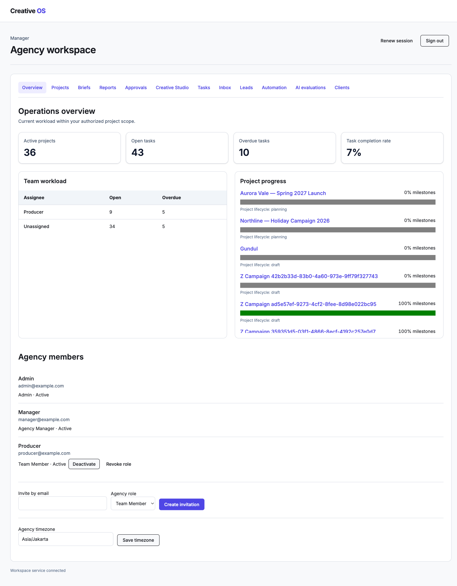
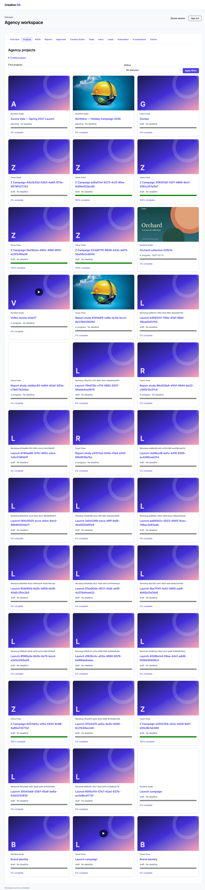
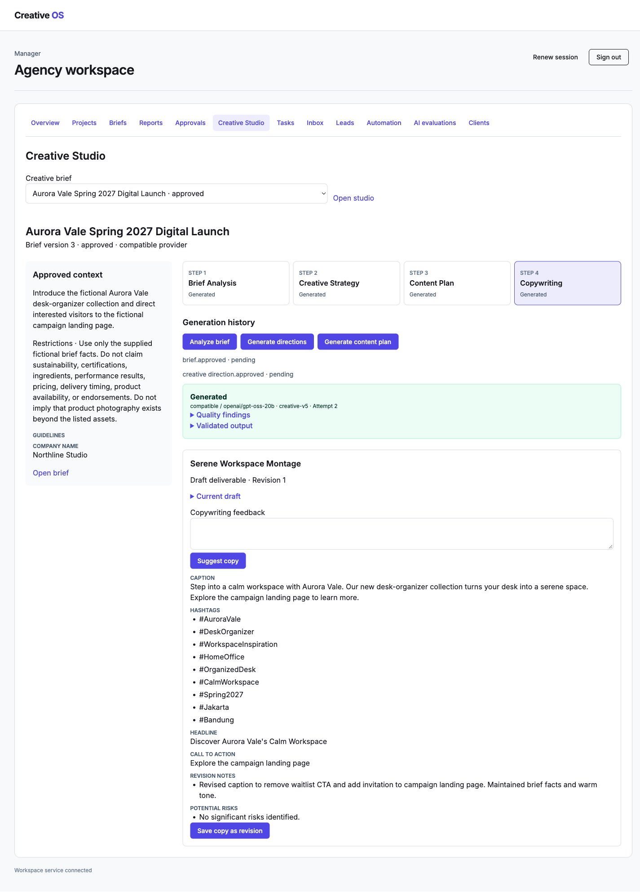
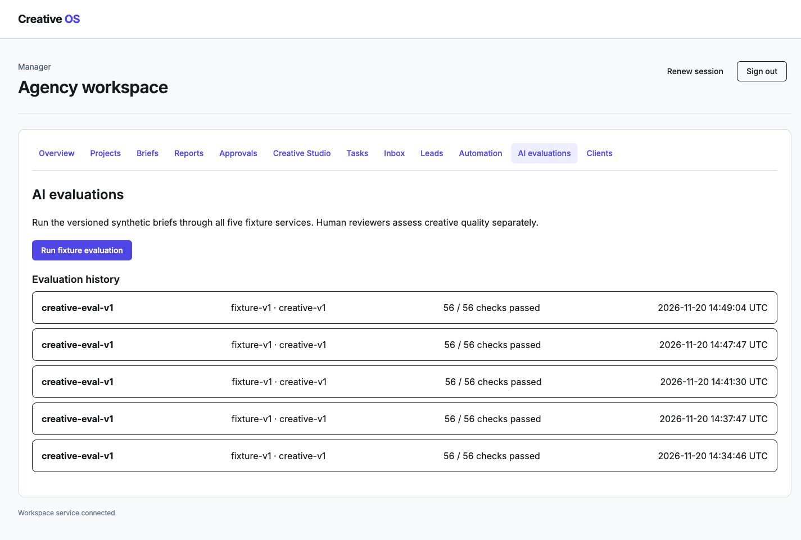
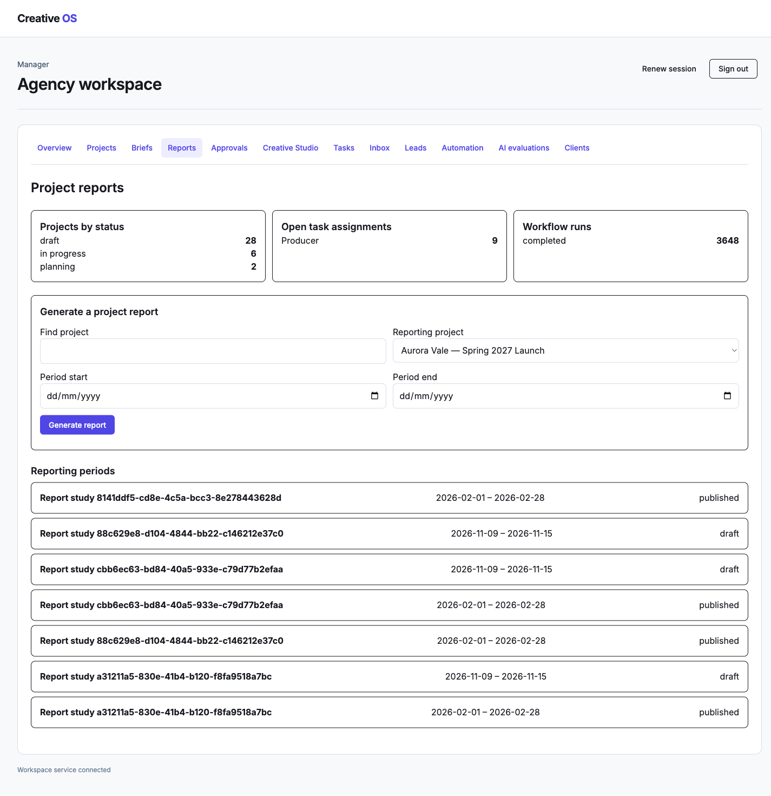

# CREATIVE OS

**AI-assisted agency operations and workflow automation platform**

CREATIVE OS connects client acquisition, briefs, AI-assisted content production, project delivery, approvals, reporting, and automation in one role-aware workspace.

## Project overview and business problem

Agencies often manage inquiries, briefs, tasks, revisions, approvals, and reporting across disconnected tools. CREATIVE OS creates a traceable record from the first lead through client approval: each brief version, AI generation, task, revision, notification, and report remains tied to an authorized project context.

This is a local portfolio MVP using synthetic data. It demonstrates integrated product and AI engineering; it is not production-ready.

## Product screenshots

| Agency operations | Creative workflow | Client and automation |
|---|---|---|
|  |  |  |
|  |  |  |
|  |  |  |

[View the complete 22-image screenshot gallery](docs/PORTFOLIO_SCREENSHOT_GALLERY.md) · [View the audited inventory](docs/PORTFOLIO_SCREENSHOT_INVENTORY.md)

## Platform capabilities

### Agency operations

- **Agency Dashboard:** workload KPIs, open and overdue tasks, team workload, and project progress.
- **Leads and Clients:** lead qualification, conversion, client records, and scoped organization management.
- **Projects and Project Details:** project lifecycle, membership, planned work, milestones, assets, and activity history.
- **Task Management and Kanban:** assignment, status, priority, due dates, filters, overdue tracking, and board/table views.
- **Project Timeline:** upcoming work and immutable project activity history.
- **Brief Management and Attachments:** versioned briefs, approval snapshots, project files, and backend-enforced visibility controls.

### AI-assisted production

- **Creative Studio:** one workspace for Brief Analysis, Creative Strategy, Content Plan, and Copywriting.
- **Brief Analysis:** structures objectives, audience, risks, and missing information from an approved snapshot.
- **Creative Strategy:** proposes two differentiated directions for human selection.
- **Content Planning:** proposes channel-specific deliverables after direction selection.
- **Copywriting:** drafts against a selected plan item and preserves revision history.

### Review and delivery

- **Internal Review and Revisions:** agency feedback, revision history, internal review, and exact-revision release.
- **Client Portal and Client Approval:** client-scoped project progress, released content review, revision requests, and approval of a specific revision.
- **Reporting:** project metrics, report generation, review, publication, and client access to published reports.
- **Notifications and Inbox:** role-scoped workflow notifications for agency and client users.
- **Automation Monitoring:** outbox events, workflow runs, delivery attempts, durations, correlation IDs, and recovery state.
- **AI Evaluation:** repeatable fixture evaluations with contract, grounding, and quality checks for human review.

## Four-stage live Groq workflow

The verified Aurora Vale chain was initiated through Creative Studio in the browser. The AI-only worker consumed each queued job automatically while preserving the normal human gates between stages.

Provider/model: compatible / openai/gpt-oss-20b · Prompt: creative-v5

| Stage | Attempt | Status | Quality |
|---|---:|---|---|
| Brief Analysis | 1 | completed | clear |
| Creative Strategy | 1 | completed | clear |
| Content Plan | 1 | completed | review |
| Copywriting | 2 | completed | clear |

The Content Plan review finding records an unconfirmed operational assumption. Copywriting completed on attempt 2; the evidence does not establish the cause of the first attempt. “Clear” reflects the implemented quality checks and does not prove factual accuracy or creative effectiveness.

Each job records the approved snapshot, upstream context, provider, model, prompt version, status, attempt count, token usage, latency, validated output, and quality findings. Pydantic contracts validate structured output before proposals are persisted. Direction selection, plan-item selection, internal release, and client approval remain authorized human actions.

## Human-in-the-loop approvals

AI output remains a proposal. The approved brief snapshot is the immutable input boundary. A manager selects one strategy direction, selects a plan item, reviews copy, and releases an exact revision. The client can request changes or approve only the released revision. Quality findings remain visible and are not bypassed by schema validation.

## System architecture and technology stack

~~~mermaid
flowchart LR
    Users[Agency and client users] --> Web[Next.js portals]
    Web --> API[FastAPI business API]
    API --> DB[(PostgreSQL)]
    API --> Files[(Private file volume)]
    DB --> Worker[Python worker]
    Worker --> AI[Fixture or compatible LLM]
    Worker --> Outbox[Transactional outbox]
    Outbox --> N8N[n8n workflows]
    N8N --> API
~~~

Next.js 16, React 19, TypeScript, Tailwind CSS, FastAPI, Python 3.12, Pydantic, SQLAlchemy, PostgreSQL 16, Alembic, Docker Compose, and n8n. WORKER_MODE=ai separates generation consumption from outbox dispatch; dispatch runs the outbox consumer; all preserves the combined default.

FastAPI owns authorization and business decisions. PostgreSQL stores authoritative state, immutable versions, jobs, audit records, and outbox events. The worker uses leases, claim tokens, retries, and attempt fencing. n8n handles external workflow orchestration and authenticated callbacks.

## Reliability and security engineering

The platform uses idempotency keys, transactional writes, leased consumers, claim-token fencing, bounded retries, notification and reminder deduplication, structured output validation, tenant-scoped authorization, revision-bound approvals, and private file delivery. Attachment visibility is enforced at metadata, listing, preview, thumbnail, stream, and download boundaries.

Targeted isolated tests covered worker modes, outbox recovery, reminders, media authorization, review workflows, and duplicate prevention. These controls are documented engineering evidence, not a complete production security audit.

## Verification evidence

- Historical CP6 baseline: 66 backend tests, 7 frontend tests, 11 browser tests, automation checks, and fixture evaluation checks. These results are historical and do not represent a fresh full-suite run after every later change.
- Four-stage Aurora Vale live Groq chain: persisted Brief Analysis, Creative Strategy, Content Plan, and Copywriting records with the metadata shown above.
- Fixture workflow: approved brief through human direction selection, content plan, task creation, copy revision, internal review, client revision request, and final client approval.
- Automation: targeted isolated regression evidence for worker modes, leases, outbox behavior, retries, reminders, and notification deduplication.
- Security: targeted attachment authorization regression evidence covering client-visible files, agency-only files, previews, streams, and direct-ID access.

See the [AI engineering case study](docs/PORTFOLIO_AI_CASE_STUDY.md) and [portfolio evidence index](docs/PORTFOLIO_EVIDENCE_INDEX.md) for provenance and boundaries.

## Local setup

Prerequisites: Docker with Compose v2 and Python 3. From the repository root:

    python3 scripts/init_env.py
    docker compose up -d --build --wait --wait-timeout 900
    python3 scripts/smoke.py
    python3 scripts/seed_local.py

Open [the application](http://localhost:3100), [the public inquiry form](http://localhost:3100/inquiry), or [local API docs](http://localhost:8100/docs). Seeded credentials are stored only in the Git-ignored .local/demo-accounts.json; do not publish that file. Fixture mode and local file storage are the normal development defaults.

Stop the stack while retaining volumes with:

    docker compose down

See the [local operations guide](docs/LOCAL_OPERATIONS.md) and [portfolio walkthrough](docs/PORTFOLIO_DEMO.md) for configuration and synthetic workflow steps.

## Known limitations

- This is a local Compose portfolio MVP, not a production deployment.
- The live AI evidence is a small synthetic sample. Quality checks are conservative and incomplete; one Content Plan result requires review.
- External integrations such as Google Drive, Google Forms forwarding, transactional email, and WhatsApp remain partial or unverified.
- n8n credential retention, deployment hardening, observability, and broader security review still require production work.
- The bounded outbox lease leaves a documented risk when an external workflow exceeds its lease window.
- Current screenshot review excludes one empty client reports page and one duplicate timeline capture; both files remain preserved locally.

## Engineering documentation

- [AI engineering case study](docs/PORTFOLIO_AI_CASE_STUDY.md)
- [Portfolio evidence index](docs/PORTFOLIO_EVIDENCE_INDEX.md)
- [Complete screenshot gallery](docs/PORTFOLIO_SCREENSHOT_GALLERY.md)
- [Screenshot inventory](docs/PORTFOLIO_SCREENSHOT_INVENTORY.md)
- [Implementation status](docs/IMPLEMENTATION_STATUS.md)
- [Local operations](docs/LOCAL_OPERATIONS.md)
- [API specification](docs/04_API_SPECIFICATION.md)
- [AI system design](docs/05_AI_SYSTEM_DESIGN.md)
- [Workflow automation](docs/06_WORKFLOW_AUTOMATION.md)
- [Database design](docs/03_DATABASE_DESIGN.md)

## Portfolio focus

Applied AI engineering · structured generation · workflow orchestration · human-governed approvals · full-stack integration · reliability and authorization engineering
