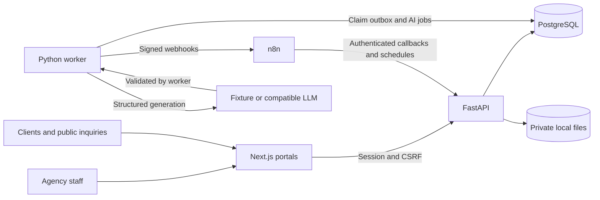
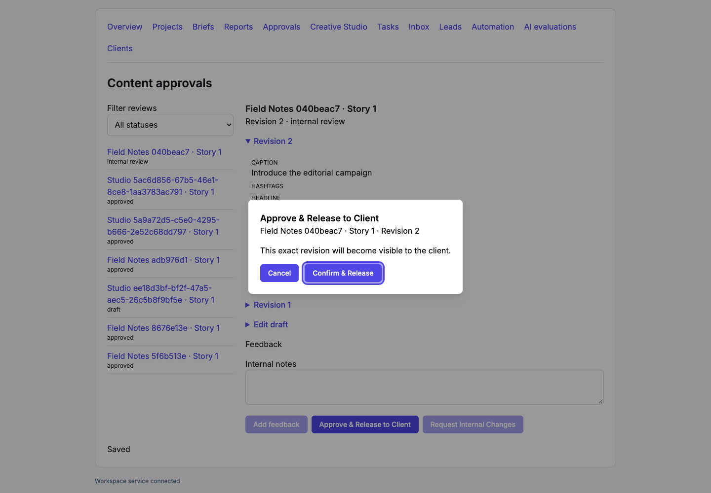
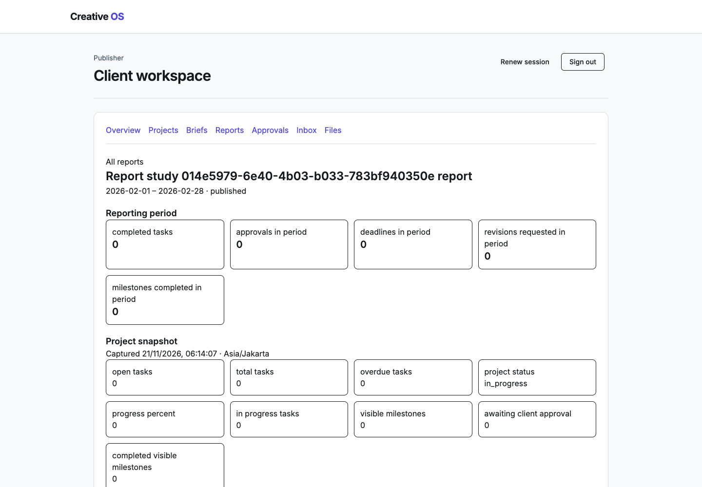

# CREATIVE OS

Creative agencies often track inquiries, briefs, revisions and approvals in separate tools. When those records drift apart, it becomes hard to tell which draft a client approved or where a progress figure came from. Creative OS connects those decisions to one project, from public inquiry to a published client report.

The local MVP has two workspaces. Agency staff qualify leads, assign work, guide AI-assisted production and publish reports. Clients submit briefs, review released revisions and see their own organization’s published work.


## Run locally

Use Docker with Compose v2 and Python 3. From the repository root run

```sh
python3 scripts/init_env.py
docker compose up -d --build --wait --wait-timeout 900
python3 scripts/smoke.py
python3 scripts/seed_local.py
```

Open the [workspace](http://localhost:3100) or the [public inquiry form](http://localhost:3100/inquiry). Use `localhost` for browser sessions. The seed generates passwords in the Git-ignored, owner-only `.local/demo-accounts.json`. Start with `manager@example.com` for the agency or `lead@example.com` for the client. The default demo uses `fixture-v1`, private local file storage and a development inbox. Stop the stack with `docker compose down` to retain its volumes.

Follow the [reproducible demo walkthrough](docs/PORTFOLIO_DEMO.md) for the full campaign, role accounts, expected results and the screenshot gallery. See the [operations guide](docs/LOCAL_OPERATIONS.md) for configuration and troubleshooting.

## Architecture



| Layer | Technology and responsibility |
|---|---|
| Frontend | Next.js 16 App Router, React 19, TypeScript, Tailwind CSS and shadcn/ui components |
| API and worker | Python 3.12, FastAPI, Pydantic and SQLAlchemy. FastAPI owns authorization and transactions. The worker claims durable jobs and outbox events |
| Data | PostgreSQL 16, Alembic migrations, and a separate private file volume |
| Orchestration | n8n 2.48.6 with authenticated HTTP callbacks and an independent metadata volume |
| Verification | Docker Compose, Pytest against PostgreSQL, Vitest and Playwright |

See the [local API explorer](http://localhost:8100/docs), [database contract](docs/03_DATABASE_DESIGN.md), and [workflow contract](docs/06_WORKFLOW_AUTOMATION.md).

## Four integrated workflows

| Workflow | What the demo covers |
|---|---|
| A · Acquisition | A public submission enters the leads queue. The manager qualifies and converts it into a client and project, then issues a single-use client invitation |
| B · Creative production | An approved brief starts analysis and strategy. A person selects a direction and plan item, edits the draft, and releases an exact revision for client sign-off |
| C · Project delivery | Project members receive assigned tasks. Scheduled deadline scans reserve and deduplicate reminders. The client sees released milestones |
| D · Reporting | PostgreSQL freezes period metrics. The summarizer drafts from those figures, and an authorized person reviews and publishes the report and its JSON export |

## AI, approvals and access

An approved brief freezes the version, brand inputs and attachment references. The worker records the input, model, prompt version and validation result for analysis, strategy, planning and copy assistance. A human selects the direction and plan item. Agency managers or admins confirm the release of an exact content revision. A Client Admin or an active delegate for that project can approve or request changes. The report summarizer uses deterministic metrics and its text remains a draft until an authorized person publishes it. [AI design](docs/05_AI_SYSTEM_DESIGN.md)

FastAPI checks active membership, role, project scope and revision identity at the API boundary. Agency Admins manage privileged roles, Agency Managers can manage Team Members, and assigned staff get scoped project access. Client organizations are isolated. Sessions use host-only cookies, expiry, revocation and same-origin CSRF checks. File reads are authorized and verified against stored hashes. Approval, audit and outbox writes commit together. [API contract](docs/04_API_SPECIFICATION.md)





## Verification

| Check | Observed result |
|---|---|
| Backend | 66 PostgreSQL tests passed. Ruff, strict mypy, clean migrations and drift checks passed |
| Frontend | Seven Vitest tests passed. Lint, TypeScript and the production build passed |
| Browser | Eleven Chrome tests passed, including the single-project inquiry-to-publication journey. A subsequent targeted restart test passed with PostgreSQL and n8n left running |
| Workflows | Real n8n executions matched PostgreSQL events, runs and inbox deliveries. Deadline and report schedules were exercised |
| AI evaluation | The versioned synthetic dataset produced 50 outputs that met schema, required-field and grounding checks. Six negative controls were rejected as expected |

Fixture results measure behavior against the synthetic contracts. Real-model usefulness, editorial quality and accuracy require human evaluation with representative outputs. See the [CP6 verification record](docs/IMPLEMENTATION_STATUS.md#cp6-final-integration-and-portfolio-demo) for exact commands, execution IDs and limitations.

## Integration readiness and limits

The verified target is a local demo for one agency and multiple client organizations. Report export is JSON. The compatible HTTPS LLM and private Google Drive transports are implemented and unverified against live providers. The Google Forms receiver is implemented, with upstream forwarding pending. Gmail and Telegram delivery are unimplemented. n8n temporarily persists JWT request headers before its prune sweep. Public operation requires the documented hardening and a separate deployment review. [Integration matrix, JWT handling and optional live LLM check](docs/LOCAL_OPERATIONS.md#integration-readiness)
