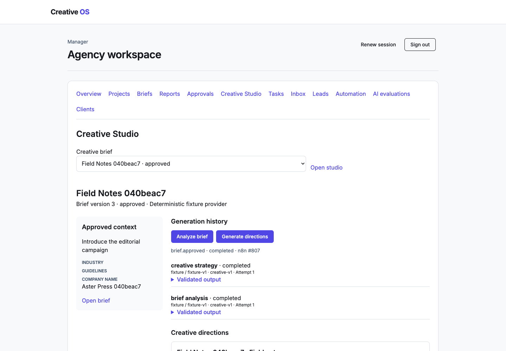
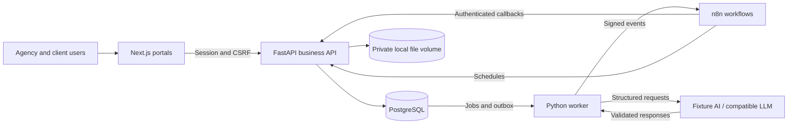

# CREATIVE OS

**AI-Assisted Agency Operations & Workflow Automation Platform**

A local-first, full-stack portfolio project that connects **client acquisition, creative briefs, AI-assisted production, task delivery, approvals, and reporting** in a single auditable workflow.

[](frontend/) [](backend/) [](docs/03_DATABASE_DESIGN.md) [](automation/n8n/) [](compose.yaml)

> **Portfolio MVP, not a production deployment.** The default environment uses synthetic data, a fixture AI provider, private local file storage, and an in-app development inbox. See [Known limitations & roadmap](#known-limitations--roadmap) before using real data.

## The business problem

Creative teams often coordinate leads, project briefs, task assignments, content revisions, client approvals, and progress updates across disconnected tools. That fragmentation makes it difficult to answer:

- **What needs attention?** Which tasks, approvals, or deadlines are pending?
- **What was approved?** Which exact brief and content revision did a client sign off?
- **Where did the report come from?** Which underlying project records support a progress metric?
- **Did the automation run?** Can an operator trace an event through its workflow execution and notification delivery?

CREATIVE OS explores how a single application can make those processes more visible and traceable, while keeping consequential decisions with people.

## What the MVP delivers

| Capability | Implemented portfolio workflow | Business value |
|---|---|---|
| **Lead intake & onboarding** | Public inquiry, lead qualification, client/project conversion, single-use invitation | Connects inquiry records to project delivery |
| **Brief management** | Project-scoped briefs, attachments, versioning, agency review, approved input snapshots | Reduces ambiguity about creative requirements |
| **AI-assisted creative studio** | Structured analysis, strategy, content planning, copy suggestions, human selection | Speeds drafting without automating final decisions |
| **Project delivery** | Project membership, task assignment, status tracking, milestones, deadline reminders | Gives teams a shared operational record |
| **Revision & approval workflow** | Agency review, exact-revision release, client feedback and sign-off | Preserves approval traceability |
| **Client reporting** | Database-derived period metrics, AI-assisted draft narrative, review and publication, JSON export | Connects published updates to recorded activity |
| **Automation monitoring** | Durable outbox, worker execution, n8n workflow correlation, development inbox | Supports troubleshooting and delivery auditing |

The system includes two role-oriented experiences: an **agency workspace** for operations and production, and a **client portal** for briefs, released deliverables, approvals, and published reports.



## End-to-end demonstration

The [reproducible portfolio walkthrough](docs/PORTFOLIO_DEMO.md) follows one synthetic client and one project:

1. A client submits a **public inquiry**; an agency manager qualifies it, creates a project, and invites the client.
2. The client submits a **creative brief**; agency approval freezes the version used for downstream work.
3. The **AI-assisted studio** proposes analysis, strategy, a plan, and draft copy. A human selects the direction and saves a revision.
4. The agency **releases an exact revision** for client review; the client requests changes or approves it.
5. Project work is **assigned and tracked**, with notifications and scheduled reminders.
6. An authorized user reviews and **publishes a project report** derived from stored metrics.

| Creative review | Client reporting |
|---|---|
|  |  |

Additional interface captures, automation monitoring, and AI evaluation screenshots are linked in the [demo gallery](docs/PORTFOLIO_DEMO.md#screenshot-gallery).

## System architecture



| Layer | Technology | Responsibility |
|---|---|---|
| Web application | Next.js 16, React 19, TypeScript, Tailwind CSS | Agency and client interfaces |
| API | Python 3.12, FastAPI, Pydantic, SQLAlchemy | Authorization, validation, business state transitions |
| Persistence | PostgreSQL 16, Alembic | Transactions, versioned records, audit events, job/outbox state |
| Background processing | Python worker | Durable AI jobs, notifications, retry and recovery |
| Orchestration | n8n 2.48.6 | Authenticated workflows, callbacks, schedules |
| Local runtime & testing | Docker Compose, Pytest, Vitest, Playwright | Reproducible development and verification |

**Design boundary:** FastAPI and PostgreSQL remain authoritative for access decisions and business state. n8n orchestrates workflows; AI proposes structured content. Neither can independently approve client deliverables or publish reports.

See the [database design](docs/03_DATABASE_DESIGN.md), [API specification](docs/04_API_SPECIFICATION.md), [AI system design](docs/05_AI_SYSTEM_DESIGN.md), and [workflow design](docs/06_WORKFLOW_AUTOMATION.md).

## AI engineering and human oversight

The AI pipeline supports brief analysis, creative strategy, planning, copywriting suggestions, and report narration. It is designed around explicit contracts rather than unrestricted autonomous execution:

- **Input provenance:** Approved brief versions, referenced assets, and structured project context are recorded.
- **Structured outputs:** Pydantic schemas and validation gates reject malformed or unsupported results.
- **Execution traceability:** Provider/model information, prompt versions, outcomes, and job state are persisted.
- **Human-in-the-loop:** Creative direction, revision release, client sign-off, and report publication require authorized human actions.
- **Controlled provider testing:** The default `fixture-v1` model enables deterministic demos. One synthetic Groq copywriting request was separately verified; this does **not** establish general real-model content quality.

For implementation details and controlled-provider boundaries, see [AI design](docs/05_AI_SYSTEM_DESIGN.md) and [CP7 verification](docs/IMPLEMENTATION_STATUS.md#cp7-controlled-groq-verification).

## Reliability and verification

The repository records the following **historical CP6 local baseline** (21 November 2026), using synthetic data and fixture-mode AI:

| Verification area | Recorded CP6 result |
|---|---|
| Backend | 66 PostgreSQL-backed tests passed; Ruff, strict mypy, and migration checks passed |
| Frontend | 7 Vitest tests passed; lint, TypeScript checks, and production build passed |
| Browser | 11 Chrome end-to-end tests passed, including an inquiry-to-publication journey |
| Automation | Actual n8n executions were correlated with PostgreSQL events and inbox deliveries; reminder and report schedules were exercised |
| AI evaluation | 50 synthetic fixture outputs passed the documented contract checks; 6 negative controls were rejected |

These figures describe the **CP6 snapshot**, not a claim that every later change has passed a fresh full regression run. Fixture contract compliance is not a measure of real-world editorial quality or factual correctness. The [implementation record](docs/IMPLEMENTATION_STATUS.md#cp6-final-integration-and-portfolio-demo) contains commands, evidence, and qualifications.

## Run locally

**Prerequisites:** Docker with Compose v2 and Python 3. Run from the repository root:

```sh
python3 scripts/init_env.py
docker compose up -d --build --wait --wait-timeout 900
python3 scripts/smoke.py
python3 scripts/seed_local.py
```

Open:

- **Application:** http://localhost:3100
- **Public inquiry:** http://localhost:3100/inquiry
- **Local API explorer:** http://localhost:8100/docs

Use `localhost` for browser sessions. Seeded identities include `manager@example.com` (agency) and `lead@example.com` (client); **generated passwords** are saved locally to the Git-ignored, owner-only `.local/demo-accounts.json`. Do not commit or share that file.

The seeded environment uses synthetic records, local file storage, `fixture-v1`, and a development inbox. To stop services without deleting data volumes:

```sh
docker compose down
```

For role-by-role instructions, use the [demo walkthrough](docs/PORTFOLIO_DEMO.md). For environment configuration, isolated test stacks, and troubleshooting, see [local operations](docs/LOCAL_OPERATIONS.md).

## Known limitations & roadmap

**Security and production readiness come first.** A manual UI acceptance test identified an **authorization defect**: a client session could download a file labeled **Agency only**. File access control needs remediation and regression testing at the backend listing, preview, and download boundaries. Do **not** upload sensitive customer files or expose this MVP as a public production service until that defect is resolved.

Other documented limitations include temporary n8n JWT-header persistence before its pruning sweep, unverified live Google Drive integration, a Google Forms receiver without upstream forwarding, and limited real-model verification. See [operations and security hardening](docs/LOCAL_OPERATIONS.md#n8n-jwt-retention-and-production-hardening).

Planned work, **not included as completed functionality in this GitHub snapshot**:

- **Operational UX:** Expanded Kanban and timeline views, dashboard refinements, unread Inbox counts and mark-all-read controls.
- **Notification channels:** Transactional email and opt-in WhatsApp delivery with preferences and delivery-status monitoring. Current notifications use the local development inbox; Gmail, Telegram, and WhatsApp delivery are not implemented.
- **Production hardening:** File authorization remediation, end-to-end access tests, secure orchestration ingress, deployment review, and provider-backed integration tests.

## Documentation

| Resource | Purpose |
|---|---|
| [Demo walkthrough & screenshots](docs/PORTFOLIO_DEMO.md) | Reproduce the client-to-report journey |
| [Local operations](docs/LOCAL_OPERATIONS.md) | Setup, configuration, integrations, troubleshooting |
| [Implementation status](docs/IMPLEMENTATION_STATUS.md) | Verified checkpoints and test evidence |
| [Product requirements](docs/01_PRODUCT_REQUIREMENTS.md) | Business scope and behavior |
| [API specification](docs/04_API_SPECIFICATION.md) | Endpoint and authorization contracts |
| [AI system design](docs/05_AI_SYSTEM_DESIGN.md) | AI contracts and review boundaries |

---

**Portfolio focus:** Applied AI engineering · API and database design · workflow orchestration · integration testing · business process automation · traceable, human-governed AI systems.
