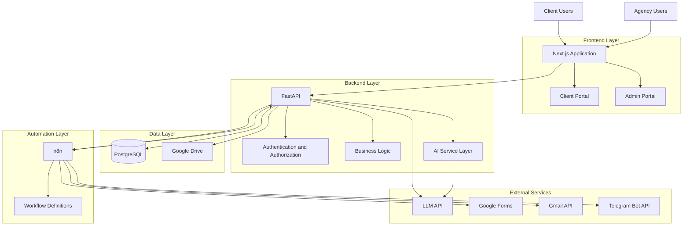
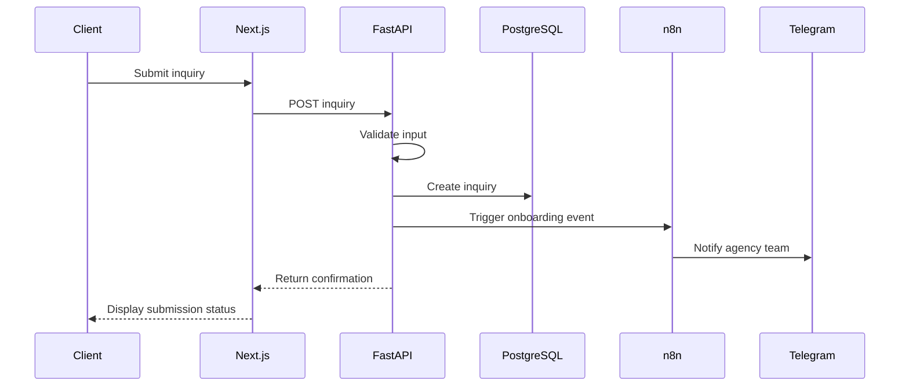
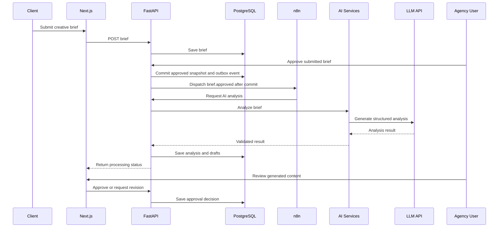
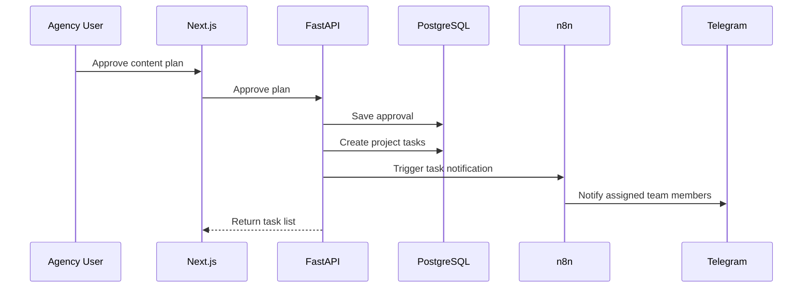
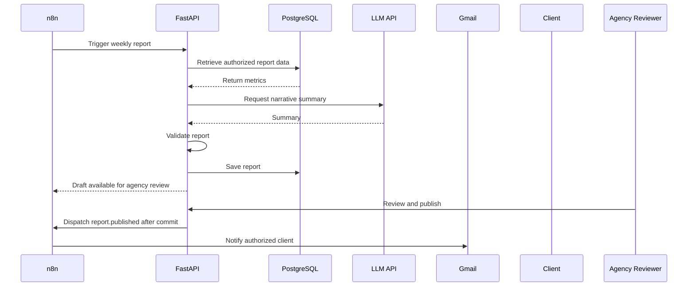

# CREATIVE OS
# System Architecture

**Document:** 02_SYSTEM_ARCHITECTURE.md  
**Version:** 1.0  
**Status:** Proposed Architecture for MVP  
**Product:** CREATIVE OS — AI-Powered Creative Agency Operations Platform

---

## 1. Architecture Overview

CREATIVE OS uses a modular web application architecture consisting of:

1. Frontend application.
2. Backend API and business logic.
3. Central relational database.
4. Workflow automation engine.
5. AI services.
6. External integrations.
7. File storage.
8. Monitoring and reporting components.

The system provides two user interfaces through one Next.js application:

- Client Portal.
- Admin Portal.

Both interfaces communicate with the same FastAPI backend.

The backend controls business logic, authorization, database access, AI service execution, and integration with external services.

n8n handles event-driven and scheduled workflow orchestration.

PostgreSQL serves as the central source of truth for application data.

## 2. High-Level Architecture



## 3. Technology Stack

### 3.1 Frontend

**Framework:** Next.js  
**Language:** TypeScript  
**Styling:** Tailwind CSS  
**Component Library:** shadcn/ui

Responsibilities:
- Render Client Portal and Admin Portal.
- Handle navigation and protected routes.
- Display project, client, content, and task information.
- Provide forms and interactive user interfaces.
- Communicate with FastAPI through HTTP APIs.
- Display loading, error, and success states.

The application must use responsive layouts for desktop, tablet, and mobile devices.

### 3.2 Backend

**Framework:** FastAPI  
**Language:** Python

Responsibilities:
- Authentication and authorization.
- Business logic.
- Input validation.
- Database operations.
- Client and project management.
- AI service orchestration.
- External API integration.
- Workflow event initiation.
- Report generation.
- Audit and activity logging.

The backend is the authoritative layer for business rules and access control.

### 3.3 Database

**Database:** PostgreSQL

Responsibilities:
- Store users and organization information.
- Store client profiles.
- Store briefs and creative requirements.
- Store projects and campaign information.
- Store generated content and approvals.
- Store tasks, assignments, and milestones.
- Store workflow execution references.
- Store activity and audit records.

PostgreSQL is the central source of truth.

External services must not become the only storage location for critical application records.

### 3.4 Workflow Automation

**Platform:** n8n

Responsibilities:
- Receive webhook events.
- Trigger client onboarding workflows.
- Orchestrate AI processing workflows.
- Trigger task and deadline notifications.
- Execute scheduled reporting.
- Integrate external services.
- Handle workflow errors and retries.
- Record workflow execution results.

n8n is responsible for orchestration, not the application's core business logic or authorization.

### 3.5 AI Services

**Implementation:** Python modules integrated with FastAPI.

Initial services:

- Brief Analyzer.
- Creative Strategist.
- Content Planner.
- Copywriting Assistant.
- Report Summarizer.

Task generation uses deterministic templates. Quality evaluation uses schema checks and a human rubric. See AI System Design §§4–5 and 11.

Responsibilities:
- Interpret creative briefs.
- Extract structured information.
- Detect missing or ambiguous requirements.
- Generate creative directions.
- Generate content ideas and copywriting drafts.
- Suggest project tasks.
- Evaluate content against brand guidelines.

AI outputs must be validated before they are persisted or used in downstream workflows.

### 3.6 External Integrations

Initial integrations:

| Integration | Purpose |
|---|---|
| Google Forms | External inquiry and brief submissions |
| Google Drive API | Document and reference storage |
| Gmail API | Email notifications |
| Telegram Bot API | Internal notifications |
| LLM API | AI analysis and content generation |

The application must also support native Client Portal forms.

## 4. Application Structure

The application consists of one frontend and one backend.

### 4.1 Frontend Routes

Suggested Client Portal routes:

- `/client/dashboard`
- `/client/projects`
- `/client/projects/[projectId]`
- `/client/briefs`
- `/client/content`
- `/client/content/[contentId]`
- `/client/files`
- `/client/reports`
- `/client/settings`

Suggested Admin Portal routes:

- `/admin/dashboard`
- `/admin/clients`
- `/admin/clients/[clientId]`
- `/admin/projects`
- `/admin/projects/[projectId]`
- `/admin/tasks`
- `/admin/content`
- `/admin/ai-workspace`
- `/admin/reports`
- `/admin/automation-logs`
- `/admin/users`
- `/admin/settings`

Authentication routes:

- `/login`
- `/register` (only if public registration is approved)
- `/forgot-password`

These routes are initial architectural proposals. Exact navigation and page requirements are defined in the UI/UX specification.

### 4.2 Backend Modules

Suggested backend structure:

```text
backend/
├── app/
│   ├── main.py
│   ├── api/
│   │   ├── routes/
│   │   └── dependencies/
│   ├── core/
│   │   ├── config.py
│   │   ├── security.py
│   │   └── permissions.py
│   ├── models/
│   ├── schemas/
│   ├── repositories/
│   ├── services/
│   ├── integrations/
│   ├── agents/
│   └── database/
├── migrations/
└── tests/
```

The backend should use clear separation between:
- API routes.
- Request and response schemas.
- Database models.
- Repository operations.
- Business services.
- External integrations.
- AI agent services.

## 5. Core Component Responsibilities

### 5.1 Frontend

The frontend must:
- Render pages according to user roles.
- Send requests to FastAPI.
- Display API responses.
- Validate basic form inputs.
- Handle authentication state.
- Provide clear feedback when operations succeed or fail.

The frontend must not:
- Connect directly to PostgreSQL.
- Store secret API keys.
- Make authorization decisions independently of the backend.
- Expose internal agency records to client users.

### 5.2 FastAPI Backend

FastAPI is the central application interface.

It must:
- Authenticate users.
- Authorize every protected operation.
- Validate incoming data.
- Enforce client-level data isolation.
- Manage database transactions.
- Execute business rules.
- Invoke AI services.
- Initiate automation workflows.
- Provide data to frontend dashboards.

### 5.3 PostgreSQL

All critical business entities must be stored in PostgreSQL.

The database must preserve:
- Referential integrity.
- Organization and client relationships.
- Project ownership.
- Task assignments.
- Content approval history.
- Workflow status.
- Relevant activity records.

Database access should be restricted to authorized backend and infrastructure services.

### 5.4 n8n

n8n coordinates multi-step processes.

It should communicate with FastAPI through authenticated API requests or webhooks.

n8n must not bypass application authorization by directly modifying business records without defined validation.

### 5.5 AI Services

AI services should be modular and callable independently.

Example:

```text
backend/app/ai/prompts/
├── brief_analyzer/
├── creative_strategist/
├── content_planner/
├── copywriting/
└── report_summarizer/
```

AI agents should return structured results validated against defined schemas.

AI outputs must remain drafts until reviewed and approved by an authorized agency user.

## 6. Data Flow Architecture

### 6.1 Client Onboarding



The backend must persist the inquiry before triggering downstream automation.

If automation fails, the inquiry must remain stored and its status must indicate that follow-up processing is needed.

### 6.2 Creative Brief Processing



The actual processing may be asynchronous. The client should be able to see whether a brief is queued, processing, ready for review, or requires additional information.

### 6.3 Project and Task Management



Task creation must be idempotent to prevent duplicate tasks when events are retried.

### 6.4 Reporting



Reports must be scoped to the intended client or agency audience.

## 7. Communication Patterns

The system uses the following communication patterns:

### 7.1 Synchronous HTTP APIs

Used for:
- Login and session operations.
- CRUD operations.
- Retrieving dashboard data.
- Submitting forms.
- Updating task status.
- Approving or rejecting content.

### 7.2 Asynchronous Workflow Events

Used for:
- AI brief processing.
- Content generation.
- Notifications.
- Scheduled reminders.
- Weekly reporting.

Long-running AI and automation tasks should not block normal frontend requests.

### 7.3 Webhooks

Used for:
- External form submissions.
- n8n-triggered workflows.
- Integration callbacks.

Webhook endpoints must authenticate incoming requests where supported.

### 7.4 Scheduled Jobs

n8n handles scheduled processes such as:
- Deadline checks.
- Reminder notifications.
- Weekly reporting.
- Pending workflow monitoring.

## 8. File and Document Storage

Google Drive is the initial external file storage integration.

PostgreSQL should store file metadata, including:
- File identifier.
- Original filename.
- MIME type.
- Related client and project.
- Storage provider.
- Uploading user.
- Upload timestamp.
- Access metadata.

Do not store public Google Drive URLs as the only security mechanism.

File access must be authorized through the application.

The system should support replacing Google Drive with an alternative storage provider in the future without redesigning the core business model.

## 9. Authentication and Authorization Architecture

Authentication and authorization must be enforced by the backend.

Initial roles:
- Client.
- Team Member.
- Admin.
- Agency Manager.

The backend must determine which resources each user can access.

Client users must only access resources belonging to their own client organization.

Suggested approach:
- Secure HTTP-only authentication cookies for browser sessions.
- Backend authorization dependencies.
- Role-based permission checks.
- Client or organization scope validation.
- Audit logging for sensitive operations.

The API specification §§4–6 defines authentication, ownership and endpoint permissions. Testing §§15–18 defines verification. Approved permission decisions are recorded in [DECISIONS.md](DECISIONS.md).

## 10. Error Handling and Reliability

The architecture must support:

- Input validation.
- API error responses.
- AI timeout handling.
- LLM provider errors.
- Workflow retry handling.
- Duplicate event prevention.
- Database transaction management.
- External API failure handling.
- Automation execution logs.

Failures in external services must not silently corrupt core application data.

For important asynchronous operations, maintain execution states such as:
- Pending.
- Processing.
- Completed.
- Failed.
- Retry required.

## 11. Observability

The system should record:

- API errors.
- AI execution status.
- Workflow execution status.
- Integration failures.
- Important user actions.
- Content approval events.
- Task and project state changes.

Sensitive information, passwords, tokens, and API secrets must never be written to application logs.

The Admin Portal should expose relevant automation and processing status.

## 12. Deployment Architecture

The MVP should use Docker Compose for local development.

Suggested services:

```text
docker-compose.yml

services:
  frontend:
    # Next.js

  backend:
    # FastAPI

  database:
    # PostgreSQL

  n8n:
    # Workflow automation
```

Additional services may be introduced only when justified by an implementation requirement.

Initial deployment must support:
- Environment-based configuration.
- Persistent database storage.
- Health checks.
- Service dependency management.
- Secure secret handling.
- Reproducible local setup.

Production hosting provider and deployment configuration will be decided separately.

## 13. Architectural Constraints

The following decisions are mandatory for the MVP:

1. One Next.js application for both Client Portal and Admin Portal.
2. FastAPI is the primary backend.
3. PostgreSQL is the central database.
4. Frontend must not access the database directly.
5. n8n is an orchestration engine, not the primary business logic layer.
6. AI services are modular backend components.
7. AI-generated content requires human approval before delivery.
8. Backend authorization is mandatory.
9. Client-level data isolation is mandatory.
10. Mechanistic Interpretability remains a separate research extension.

## 14. Future Scalability

The MVP should remain modular enough to support future extensions:

- Additional LLM providers.
- Social media publishing integrations.
- Social media analytics.
- Advanced team resource planning.
- Client billing and invoicing.
- Advanced reporting.
- More sophisticated AI evaluation.
- Mechanistic Interpretability experiments.

These extensions must not delay the initial end-to-end MVP.

## 15. Architecture Acceptance Criteria

The architecture is considered implemented when:

- Next.js can communicate with FastAPI.
- FastAPI can connect to PostgreSQL.
- n8n can receive authenticated workflow events.
- FastAPI can invoke AI services.
- AI outputs can be validated and stored.
- Client and admin access are separated.
- Client-level data isolation is enforced.
- External integration failures can be detected.
- The core application services can run through Docker Compose.
- Critical data flows can be tested end-to-end.

---

**End of Document**