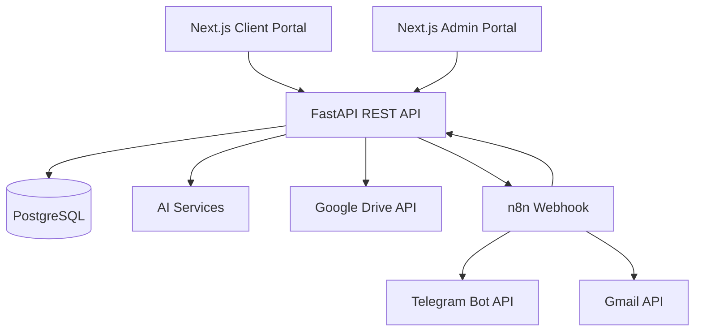
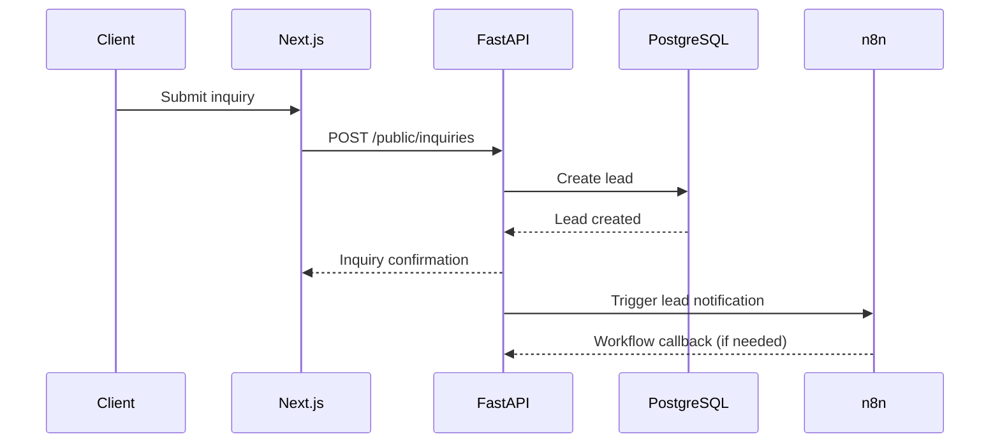
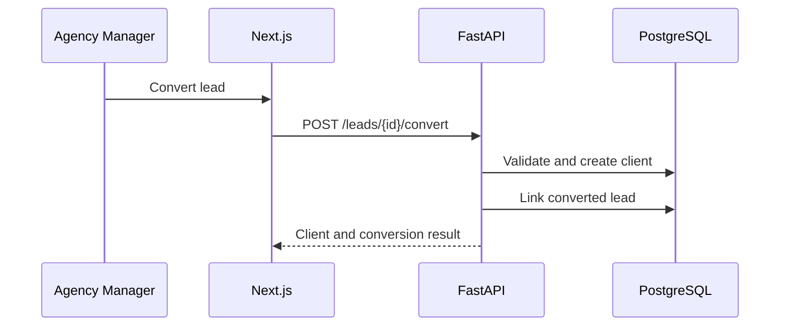
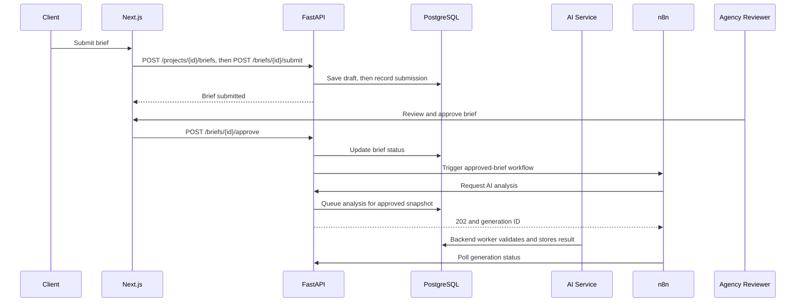
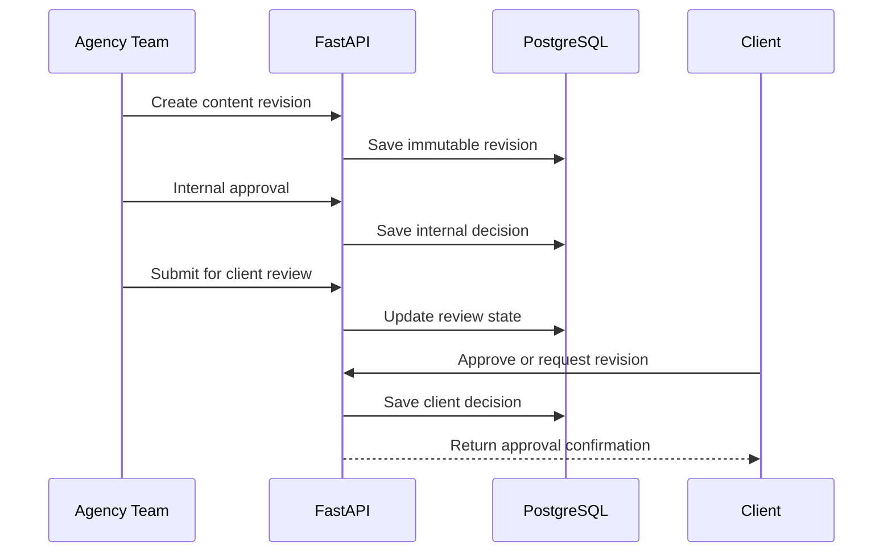
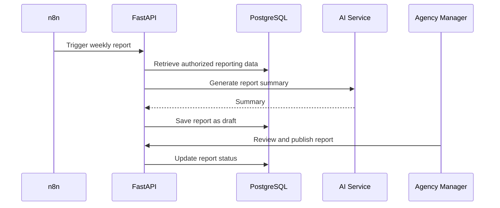

# CREATIVE OS — API Specification

**Document:** API Specification  
**Version:** 1.0  
**Status:** Proposed  
**Backend:** Python + FastAPI  
**Frontend:** Next.js + TypeScript  
**Database:** PostgreSQL  
**Automation:** n8n

---

## 1. Purpose

This document defines the REST API contract for CREATIVE OS.

It specifies:
- API conventions and response formats.
- Authentication and authorization.
- Client and agency access boundaries.
- Endpoint definitions.
- Request and response examples.
- Business workflow orchestration.
- Integration between FastAPI, n8n, AI services, and external providers.
- Error handling and API security.

FastAPI is the central backend and business logic layer.

Next.js communicates with FastAPI through HTTP APIs. n8n orchestrates automation but must not bypass FastAPI authorization or directly modify core business records.

## 2. API Architecture



Responsibilities:

| Component | Responsibility |
|---|---|
| Next.js | User interface and frontend validation |
| FastAPI | Authentication, authorization, validation, and business logic |
| PostgreSQL | Persistent application data |
| AI Services | Brief analysis, creative direction, content generation, and report summaries |
| n8n | Workflow orchestration and external notifications |
| Google Drive | File storage |
| Telegram | Internal agency notifications |
| Gmail | Email notifications |

All business data mutations must be authorized and processed through FastAPI.

## 3. API Conventions

### 3.1 Base URL

Local development:

`http://localhost:8000/api/v1`

Production:

`https://api.<your-domain>/api/v1`

The production domain must be configured through environment variables and deployment configuration.

### 3.2 HTTP methods

| Method | Purpose |
|---|---|
| GET | Retrieve resources |
| POST | Create resources or execute actions |
| PATCH | Partially update resources |
| PUT | Replace a resource when appropriate |
| DELETE | Delete or deactivate resources when explicitly supported |

Prefer explicit action endpoints for important business operations.

Examples:

- `POST /leads/{lead_id}/convert`
- `POST /briefs/{brief_id}/approve`
- `POST /content-items/{content_id}/generate`
- `POST /content-items/{content_id}/submit-for-client-review`

Do not implement important business transitions as arbitrary status updates.

### 3.3 Response format

Successful responses should use a consistent structure.

Example:

```json
{
  "data": {
    "id": "uuid",
    "name": "Summer Campaign"
  },
  "meta": {
    "request_id": "request-uuid"
  }
}
```

Collection response:

```json
{
  "data": [
    {
      "id": "uuid",
      "name": "Summer Campaign"
    }
  ],
  "meta": {
    "page": 1,
    "page_size": 20,
    "total": 45,
    "total_pages": 3
  }
}
```

Error response:

```json
{
  "error": {
    "code": "RESOURCE_NOT_FOUND",
    "message": "The requested resource was not found.",
    "details": null
  },
  "meta": {
    "request_id": "request-uuid"
  }
}
```

Do not expose stack traces, SQL statements, secrets, or internal infrastructure details in production error responses.

### 3.4 Pagination

Use:

- `page`: default 1.
- `page_size`: default 20.
- Maximum `page_size`: 100.

Example:

`GET /projects?page=1&page_size=20`

### 3.5 Filtering and sorting

Support filtering where useful.

Examples:

- `GET /projects?status=in_progress`
- `GET /tasks?assignee_id=<uuid>`
- `GET /leads?status=new`
- `GET /content-items?status=client_review`
- `GET /notifications?unread=true`

Sorting:

`GET /tasks?sort_by=due_date&sort_order=asc`

Only explicitly allowed filter and sort fields should be accepted.

### 3.6 Date and time

- Use ISO 8601 for date-time values.
- Use UTC internally for timestamps.
- Return timezone-aware timestamps.
- Use date-only fields for business deadlines where time of day is not required.

Example:

`2026-11-20T08:00:00Z`

## 4. Authentication and Authorization

### 4.1 Authentication

The MVP uses email and password authentication.

Recommended browser authentication approach:

- Secure HTTP-only cookies.
- `Secure` enabled in production.
- Appropriate `SameSite` configuration.
- CSRF protection for cookie-authenticated state-changing requests.
- Password hashing with Argon2id or another approved secure algorithm.
- Short-lived access sessions with a secure renewal mechanism.

Next.js must not store long-lived authentication tokens in local storage.

### 4.2 Authentication endpoints

| Method | Endpoint | Description |
|---|---|---|
| POST | `/auth/register` | Register an invited or permitted account |
| POST | `/auth/login` | Authenticate user |
| POST | `/auth/logout` | End current session |
| GET | `/auth/me` | Get authenticated user and memberships |
| POST | `/auth/refresh` | Renew authentication session |
| POST | `/auth/forgot-password` | Request password reset |
| POST | `/auth/reset-password` | Reset password using a valid token |

Registration rules:

- Public client inquiry does not automatically create a login account.
- Client portal accounts should initially be created through an agency invitation.
- Agency registration requires a valid agency invitation. Admins may invite any agency role. Managers may invite Team Members under §4.6. Redeem through /auth/register with the stored email and role, rechecking issuer and target eligibility.
- If self-registration is enabled later, it must include an explicit verification and onboarding process.

### 4.3 Authorization roles

Agency roles:

| Role | Permissions |
|---|---|
| `admin` | Full system administration and agency data access |
| `agency_manager` | Manage clients, project assignments, tasks, workflows, reports, non-security settings and Team Member memberships under §4.6 |
| `team_member` | Access assigned projects and perform authorized tasks |

Client roles:

| Role | Permissions |
|---|---|
| `client_admin` | Access own client data, manage permitted client-side users, submit briefs, make binding decisions and delegate those decisions per project |
| `client_member` | Access permitted client projects, briefs, deliverables and reports. Give feedback. Bind a review only under an active project delegation |

FastAPI enforces the following permission matrix. Client columns require an active account and active membership in the resource’s owning client. “Delegated” is a client_member with an active grant on the specific project. “Allowed” on a decision also requires the exact pending client-stage submission. Roles from separate portal contexts never combine.

| Operation | Admin | Manager | Team Member | Client Admin | Client Member | Delegated |
|---|---|---|---|---|---|---|
| Manage Team Member membership | Allowed | Team targets only | Denied | Denied | Denied | Denied |
| Manage Admin or Manager roles | Allowed | Denied | Denied | Denied | Denied | Denied |
| Manage authentication or security settings | Allowed | Denied | Denied | Denied | Denied | Denied |
| Manage agency-wide project assignments, tasks and workflows | Allowed | Allowed | Denied | Denied | Denied | Denied |
| Manage agency operational settings | Allowed | Allowed | Denied | Denied | Denied | Denied |
| Manage client approval delegations | Denied | Denied | Denied | Allowed | Denied | Denied |
| Comment as client on released revision | Denied | Denied | Denied | Allowed | Allowed | Allowed |
| Approve submitted revision as client | Denied | Denied | Denied | Allowed | Denied | Allowed |
| Request revision as client | Denied | Denied | Denied | Allowed | Denied | Allowed |

“Team targets only” excludes the manager’s own identity and anyone holding an Admin or Manager membership, including suspended memberships. Every administrator is subject to the last-active-Admin invariant. Assigned project work by a team member remains governed by §§5.4–5.5.

### 4.4 Client isolation

For every client-facing endpoint:

1. Authenticate the user.
2. Retrieve the user's active client memberships.
3. Verify access to the requested client.
4. Verify access to the specific resource.
5. Return only fields permitted for that role.

Do not trust `client_id` supplied by the frontend without checking membership.

Do not expose internal agency notes, internal comments, unpublished drafts, internal task details, or cross-client analytics to client users.

### 4.5 Resource ownership

For agency users, some operations require project assignment or elevated permissions.

For client users, access must be restricted to the client organization associated with the resource.

The MVP may allow agency managers and admins to access all agency clients, while team members should access projects to which they are assigned.

---

### 4.6 Agency membership administration

| Method | Endpoint | Effect |
|---|---|---|
| GET | `/agency/members` | Admin/Manager roster with permitted membership actions per target |
| POST | `/agency/invitations` | Issue a single-use email-bound invitation for one authorized role |
| PUT | `/agency/members/{user_id}/roles/{role}` | Grant role to an existing user as an active membership |
| PATCH | `/agency/members/{user_id}/roles/{role}` | Set membership is_active, the only accepted field |
| DELETE | `/agency/members/{user_id}/roles/{role}` | Revoke this role and preserve the audit history |

Authenticate the actor, enforce CSRF, then check the requested role and all target memberships, including on existing-account invitations. Only Admins can administer elevated roles, global account status, authentication policy or security settings. Managers may administer another team-only target or grant team_member to an eligible new staff member. Their operations leave the global account and unrelated client memberships intact. Scope operational settings to an allowlist and reject security fields. Re-read authority under the database §4.1 lock. Return 403 for a forbidden action, 409 for loss of the last active Admin. Record each effective mutation and invitation acceptance in the same transaction as its audit entry.

CP1 also exposes `PATCH /agency/members/{user_id}/account` (Admin only, is_active), and `GET/PATCH /agency/settings/operations` (Admin or Manager, timezone). Account deactivation invalidates existing sessions. These operations use the same transactional guard and audit trail.

### 4.7 Project approval authority

| Method | Endpoint | Effect |
|---|---|---|
| GET | `/projects/{project_id}/approval-delegations` | Owning client_admin lists current grants and eligible active client members for this project |
| PUT | `/projects/{project_id}/approval-delegations/{membership_id}` | Owning client_admin grants binding review authority for this project |
| DELETE | `/projects/{project_id}/approval-delegations/{membership_id}` | Owning client_admin revokes the project grant |

Resolve project and both memberships server-side. Require an active same-client client_admin as actor and an active same-client client_member as grantee for issuance. Duplicate grants and repeated revocations are idempotent. Record each effective change in activity_logs. These operations accept no role, client override or delegation-management capability. An active grant authorizes only the two client decision endpoints in §5.8. Deny same-client actors lacking authority with 403 and conceal out-of-scope targets with 404.

The CP1 client workspace uses `GET /clients/{client_id}/projects` to list project ownership roots. `GET /projects/{project_id}/approval-authority` returns project-scoped has_binding_authority and can_manage_delegations. A subsequent deliverable decision must reauthorize the live submission under its transaction. For client profile reads, the default portal context checks membership. Agency-wide readers explicitly request `?portal=agency` and FastAPI checks the agency role.

## 5. API Modules and Endpoints

All routes below are relative to `/api/v1`. “Authorized Agency” requires an active agency membership. Admins and managers have agency scope. Team members require project assignment and the permission for the action. “Authorized Client” requires a current membership in the owning organization and the permission for the action. Only active agency members assigned to the parent project are eligible task assignees. A task assignment alone grants no access to unrelated projects. For users with multiple memberships authorize the selected portal and organization independently. Apply these checks to lists, counts, nested IDs, details, downloads, notifications and writes. Return 404 for resources outside scope. See [DECISIONS.md](DECISIONS.md) for the approved sign-off and agency role administration policies.

For portal-wide lists use paginated `GET /tasks` (agency), `GET /briefs`, `GET /content-items`, `GET /files` and `GET /reports` with the same scope and projections as their project/detail routes. Filter approvals by review stage. Team dashboards use `GET /dashboard/team`. Project progress and milestone release are server decisions. Client-safe lists, including files, filter before pagination and aggregation.

## 5.1 Dashboard

| Method | Endpoint | Access | Description |
|---|---|---|---|
| GET | `/dashboard/client` | Client | Client-specific dashboard |
| GET | `/dashboard/agency` | Admin, Manager | Agency-wide operational dashboard |
| GET | `/dashboard/team` | Team Member | Assigned work and workload summary |

Client dashboard should include:
- Active projects.
- Project progress.
- Upcoming milestones.
- Content awaiting client approval.
- Recent notifications.
- Latest client reports.

Agency dashboard should include:
- Active clients.
- Active projects.
- Open tasks.
- Overdue tasks.
- Pending approvals.
- Recent leads.
- Workflow failures.
- Team workload summary.

Team dashboard should include:
- Assigned tasks.
- Upcoming deadlines.
- Overdue tasks.
- Projects requiring attention.

The backend should calculate dashboard aggregates from authorized database records.

Do not calculate agency-wide statistics from data exposed to a client user.

## 5.2 CRM and Leads

| Method | Endpoint | Access | Description |
|---|---|---|---|
| POST | `/public/inquiries` | Public | Submit an inquiry |
| GET | `/leads` | Admin, Manager | List leads |
| GET | `/leads/{lead_id}` | Admin, Manager | Get lead details |
| PATCH | `/leads/{lead_id}` | Admin, Manager | Update lead |
| POST | `/leads/{lead_id}/assign` | Admin, Manager | Assign lead |
| POST | `/leads/{lead_id}/convert` | Admin, Manager | Convert lead into client |
| POST | `/leads/{lead_id}/reject` | Admin, Manager | Reject lead |

### Public inquiry request

`POST /public/inquiries`

Request:

```json
{
  "company_name": "Example Brand",
  "contact_name": "Alex Morgan",
  "email": "alex@example.com",
  "phone": "+628123456789",
  "industry": "Food and Beverage",
  "service_interest": "Social Media Management",
  "inquiry_message": "We need help developing our digital content strategy."
}
```

Response:

```json
{
  "data": {
    "id": "lead-uuid",
    "status": "new",
    "message": "Your inquiry has been submitted successfully."
  }
}
```

Rules:
- Public inquiries must be rate-limited.
- Validate email and required fields.
- Add basic spam protection.
- Do not expose internal lead information.
- Trigger an internal notification after successful creation.

### Lead conversion

`POST /leads/{lead_id}/convert`

Request:

```json
{
  "brand_name": "Example Brand",
  "industry": "Food and Beverage",
  "create_initial_project": true,
  "initial_project_name": "Social Media Launch"
}
```

Response:

```json
{
  "data": {
    "lead_id": "lead-uuid",
    "client_id": "client-uuid",
    "project_id": "project-uuid",
    "status": "converted"
  }
}
```

Rules:
- Conversion must be transactional.
- Duplicate conversion must be prevented.
- The original lead must remain available for historical reference.
- If initial project creation is requested, create it within the same transaction.
- Account invitations are a separate action. Only qualified or proposal_sent leads can convert. Use PATCH for pre-conversion qualification and follow-up, and the explicit actions for conversion and rejection. Serialize conversion against the lead. A replay cannot create a second client or project.
- Manual agency intake uses `POST /leads` (Admin, Manager) with the inquiry fields and source manual.

## 5.3 Client Management

| Method | Endpoint | Access | Description |
|---|---|---|---|
| GET | `/clients` | Admin, Manager | List clients |
| POST | `/clients` | Admin, Manager | Create client |
| GET | `/clients/{client_id}` | Authorized Agency, Client | Get client details |
| PATCH | `/clients/{client_id}` | Admin, Manager | Update client |
| POST | `/clients/{client_id}/archive` | Admin, Manager | Archive client |
| GET | `/clients/{client_id}/members` | Authorized Agency, Client Admin | List memberships |
| POST | `/clients/{client_id}/invitations` | Admin, Manager | Invite client user |

Invitation creation accepts email and client role. An authorized manager or admin can list invitations at `GET /clients/{client_id}/invitations` and revoke an unused invitation at `POST /clients/{client_id}/invitations/{invitation_id}/revoke`. Registration redeems the single-use token via `POST /auth/register`. FastAPI derives email, client and role from the invitation. Existing users sign in before adding a membership. Return safe invitation metadata to the management UI.

## 5.4 Project Management

| Method | Endpoint | Access | Description |
|---|---|---|---|
| GET | `/projects` | Authorized Agency, Client | List accessible projects |
| POST | `/projects` | Admin, Manager | Create project |
| GET | `/projects/{project_id}` | Authorized Agency, Client | Project details |
| PATCH | `/projects/{project_id}` | Authorized Agency | Update project |
| POST | `/projects/{project_id}/archive` | Admin, Manager | Archive project |
| GET | `/projects/{project_id}/progress` | Authorized Agency, Client | Project progress |
| GET | `/projects/{project_id}/members` | Authorized Agency | Project members |
| POST | `/projects/{project_id}/members` | Admin, Manager | Assign project member |
| DELETE | `/projects/{project_id}/members/{user_id}` | Admin, Manager | Remove project member |

Client-facing project details must be filtered to exclude internal information.

### Create project request

`POST /projects`

```json
{
  "client_id": "client-uuid",
  "name": "Summer Campaign",
  "description": "Campaign for the summer product launch.",
  "service_type": "Social Media Management",
  "priority": "high",
  "start_date": "2026-11-20",
  "due_date": "2026-12-20"
}
```

Only authorized agency users can create projects.

## 5.5 Milestones and Tasks

| Method | Endpoint | Access | Description |
|---|---|---|---|
| GET | `/projects/{project_id}/milestones` | Authorized Agency, Client | List milestones |
| POST | `/projects/{project_id}/milestones` | Authorized Agency | Create milestone |
| PATCH | `/milestones/{milestone_id}` | Authorized Agency | Update milestone |
| GET | `/projects/{project_id}/tasks` | Authorized Agency | List internal tasks |
| POST | `/projects/{project_id}/tasks` | Authorized Agency | Create task |
| GET | `/tasks/{task_id}` | Authorized Agency | Task details |
| PATCH | `/tasks/{task_id}` | Authorized Agency | Update task |
| POST | `/tasks/{task_id}/assign` | Authorized Agency | Assign task |
| POST | `/tasks/{task_id}/complete` | Authorized Agency | Complete task |

Rules:
- Client users may see project-level progress and approved milestones.
- Internal task descriptions, internal notes, and staff assignments are not automatically exposed to clients.
- Team members may only update tasks they are authorized to access.
- Deadline changes and status transitions must be validated.

## 5.6 Creative Briefs

| Method | Endpoint | Access | Description |
|---|---|---|---|
| GET | `/projects/{project_id}/briefs` | Authorized Agency, Client | List briefs |
| POST | `/projects/{project_id}/briefs` | Authorized Client, Agency | Create brief |
| GET | `/briefs/{brief_id}` | Authorized Agency, Client | Get brief |
| PATCH | `/briefs/{brief_id}` | Authorized Agency, Client | Update permitted brief fields |
| POST | `/briefs/{brief_id}/submit` | Authorized Client | Submit brief |
| POST | `/briefs/{brief_id}/request-revision` | Authorized Agency | Request changes |
| POST | `/briefs/{brief_id}/approve` | Authorized Agency | Approve brief |

Creating a brief saves a draft. Submit explicitly, including after a requested revision. Submitted briefs can enter under_review via `POST /briefs/{brief_id}/start-review`. From submitted or under_review an authorized reviewer may approve, request revision with feedback, or reject via `POST /briefs/{brief_id}/reject`. Approve atomically persists the snapshot and brief.approved event. Changes to approved fields start a draft. Include the expected brief version on writes and return 409 on stale input. Increment the version on each change. Only the latest approved version may start new creative work.

### Brief creation request

`POST /projects/{project_id}/briefs`

```json
{
  "title": "Holiday Campaign Brief",
  "objective": "Increase brand awareness during the holiday season.",
  "target_audience": "Young professionals aged 22-35.",
  "key_message": "Celebrate the season with our new collection.",
  "content_type": "Social Media Campaign",
  "preferred_channels": [
    "Instagram",
    "TikTok"
  ],
  "tone_of_voice": "Friendly and energetic",
  "references": [
    {
      "type": "url",
      "value": "https://example.com/reference"
    }
  ],
  "restrictions": "Avoid unsupported product claims."
}
```

Rules:
- Client users may only create briefs for their own projects.
- A submitted brief should not be silently modified.
- Revisions should preserve historical context where necessary.
- Brief approval may trigger AI analysis.

## 5.7 AI Generation

| Method | Endpoint | Access | Description |
|---|---|---|---|
| POST | `/briefs/{brief_id}/analyze` | Authorized Agency | Analyze brief |
| POST | `/briefs/{brief_id}/generate-creative-direction` | Authorized Agency | Generate creative direction |
| POST | `/briefs/{brief_id}/generate-content-plan` | Authorized Agency | Generate content plan |
| POST | `/content-items/{content_id}/generate` | Authorized Agency | Generate or regenerate content |
| GET | `/ai-generations/{generation_id}` | Authorized Agency | Get generation details |
| GET | `/projects/{project_id}/ai-generations` | Authorized Agency | List generation history |

### AI generation request

`POST /briefs/{brief_id}/generate-content-plan`

```json
{
  "direction_proposal_id": "approved-direction-uuid",
  "target_count": 5,
  "channels": [
    "Instagram",
    "TikTok"
  ],
  "include": [
    "content_pillar",
    "caption",
    "visual_direction",
    "call_to_action"
  ]
}
```

Each generation POST accepts an `Idempotency-Key`. A first request commits a pending generation and returns HTTP 202 with a pollable ID.

```json
{
  "data": {
    "generation_id": "generation-uuid",
    "status": "pending"
  }
}
```

Poll `GET /ai-generations/{generation_id}` for pending, running, completed, failed or cancelled. A completed response includes generation_type and validated output matching AI §5 (for a plan, `output.content_plan` with `content_format` and `draft_caption`). Optional request fields cannot remove required schema fields. Show safe error details on failure. Matching replays return the existing record even after completion. A changed payload under the same key returns 409. Intentional regeneration gets a new key. A restartable worker executes persisted jobs through backend services.

| Method | Endpoint | Authorized agency action |
|---|---|---|
| GET | `/briefs/{brief_id}/proposals` | List structured proposals, generation, snapshot, decision and reviewer |
| POST | `/proposals/{proposal_id}/approve` | Accept a direction or select a plan item. On direction approval emit creative_direction.approved. On plan item approval create its template tasks once. |
| POST | `/proposals/{proposal_id}/reject` | Record human rejection of a pending proposal |

Resolve each proposal’s owner and approved snapshot server-side. Analysis precedes strategy. Planning requires a human-approved direction on that same snapshot. Regenerated proposals have new IDs and require new decisions.

## 5.8 Content Management and Approval

| Method | Endpoint | Access | Description |
|---|---|---|---|
| GET | `/projects/{project_id}/content-items` | Authorized Agency, Client | List visible content |
| POST | `/projects/{project_id}/content-items` | Authorized Agency | Create draft and first revision atomically. Given an approved plan proposal ID, create or return its unique draft item. |
| GET | `/content-items/{content_id}` | Authorized Agency, Client | Get content details |
| PATCH | `/content-items/{content_id}` | Authorized Agency | Update content metadata |
| GET | `/content-items/{content_id}/revisions` | Authorized Agency, Client | List permitted revisions |
| POST | `/content-items/{content_id}/revisions` | Authorized Agency | Create revision |
| POST | `/content-items/{content_id}/internal-approval` | Authorized Agency | Record internal approval |
| POST | `/content-items/{content_id}/submit-for-client-review` | Authorized Agency | Make reviewed content available to client |
| POST | `/content-items/{content_id}/client-approval` | Owning Client Admin or active project delegate | Approve the pending submitted revision |
| POST | `/content-items/{content_id}/request-revision` | Owning Client Admin or active project delegate | Record a binding revision request with feedback |
| GET | `/content-items/{content_id}/feedback` | Authorized Agency, Client | Retrieve permitted feedback |
| POST | `/content-items/{content_id}/feedback` | Authorized Agency, Client | Submit feedback |

### Revision lifecycle

`POST /content-items/{content_id}/submit-for-internal-review` takes revision_id and creates a pending internal approval for the current draft. Internal approval accepts approved, rejected or revision_requested. Only an internally approved current revision may enter client_review. Submission creates a pending client-stage approval. A revision request requires meaningful feedback. A newer revision supersedes pending reviews and re-enters draft. Recheck the current revision and pending stage under the item lock before accepting a decision. Return 409 for a stale or already decided review. Clients can view released revisions, with client-visible feedback, and act only on the active release. Never resolve a client preview via an unfiltered current_revision_id.

### Internal approval request

`POST /content-items/{content_id}/internal-approval`

```json
{
  "revision_id": "revision-uuid",
  "decision": "approved",
  "comments": "The copy and visual direction are ready for client review."
}
```

### Submit for client review

`POST /content-items/{content_id}/submit-for-client-review`

```json
{
  "revision_id": "revision-uuid"
}
```

Rules:
- Only internally approved revisions can be submitted for client review.
- The client should only see the exact revision submitted for review.
- A later revision requires a new review cycle.

### Client approval request

`POST /content-items/{content_id}/client-approval`

```json
{
  "revision_id": "revision-uuid",
  "decision": "approved",
  "comments": "Approved. Please proceed."
}
```

Rules:
- The revision must belong to the requested content item.
- For both binding endpoints FastAPI resolves revision → content item → project → client, checks the active user and client membership, then requires client_admin or an active delegation to that client_member for that project. Recheck under the same locks as revocation and conditionally resolve the pending request once. On success commit exactly one decision, audit entry and corresponding event. Concurrent or repeated decisions on the resolved request return 409. A member with read access but no authority receives 403.
- Return permitted actions for the exact client review in the content detail response (comment, approve, request_revision). Project details expose whether the caller can manage approval delegations. Invalidate cached actions after a change. The backend always rechecks the mutation.
- The revision must currently be available for client review.
- Client approval does not mean social media publication.
- Record the reviewer and decision timestamp.

### Feedback request

`POST /content-items/{content_id}/feedback`

```json
{
  "revision_id": "revision-uuid",
  "visibility": "client_visible",
  "message": "Please make the opening sentence more engaging."
}
```

The backend must enforce the visibility rules based on the user's role. A client comment is non-binding. It can never change a review decision or trigger a revision request.

## 5.9 File Management

| Method | Endpoint | Access | Description |
|---|---|---|---|
| POST | `/files/upload` | Authorized Agency, Client | Upload file |
| GET | `/files/{file_id}` | Authorized Agency, Client | Get file metadata |
| GET | `/files/{file_id}/download` | Authorized Agency, Client | Download authorized file |
| DELETE | `/files/{file_id}` | Authorized Agency | Remove or archive file reference |

Rules:
- Validate file size and MIME type. Check parent ownership, file visibility and any associated revision release or report publication on list, detail and download. Uploading against another client’s project or attaching another client’s file must fail.
- Check client ownership.
- Do not expose unrestricted Google Drive links.
- Use short-lived authorized download links or backend-mediated downloads where appropriate.
- Prevent path traversal and unsafe file handling.

## 5.10 Notifications

| Method | Endpoint | Access | Description |
|---|---|---|---|
| GET | `/notifications` | Authenticated User | List own notifications |
| GET | `/notifications/unread-count` | Authenticated User | Count unread notifications |
| POST | `/notifications/{notification_id}/read` | Notification Owner | Mark notification as read |
| POST | `/notifications/read-all` | Authenticated User | Mark own notifications as read |

Rules:
- Users can only access their own notifications.
- Internal agency notifications must not be visible to client users.
- Delivery failures should be recorded.
- External notification delivery should be handled through n8n or an approved notification service.

## 5.11 Reporting

| Method | Endpoint | Access | Description |
|---|---|---|---|
| GET | `/projects/{project_id}/reports` | Authorized Agency, Client | List project reports |
| POST | `/projects/{project_id}/reports/generate` | Authorized Agency | Generate project report |
| GET | `/reports/{report_id}` | Authorized Agency, Client | Retrieve report |
| GET | `/reports/{report_id}/download` | Authorized Agency, Client | Download report |
| PATCH | `/reports/{report_id}` | Authorized Agency | Edit draft narrative. Editing a review-ready report returns it to draft. |
| POST | `/reports/{report_id}/submit-for-review` | Authorized Agency | Move a completed draft into ready_for_review |
| POST | `/reports/{report_id}/publish` | Authorized Agency | Make report available to client |

Agency reporting:

| Method | Endpoint | Access | Description |
|---|---|---|---|
| GET | `/agency/reports/operations` | Admin, Manager | Agency operational report |
| GET | `/agency/reports/workload` | Admin, Manager | Team workload report |
| GET | `/agency/reports/workflows` | Admin, Manager | Automation execution report |

Rules:
- Client reports must be scoped to the client's own projects.
- Agency reports must not be accessible to client users.
- Report publication must be an explicit action.
- Generate returns 202 with report ID and generating status on creation. Poll report detail. A validated summary produces draft, a terminal generation error produces failed. Preserve metrics on failure. Retry with the same period against the failed record. Publish requires ready_for_review, a human reviewer and timestamp. Emit report.published once. Client lists, details and downloads require published and matching client/project. The internal service can generate drafts only.

## 5.12 Workflow Monitoring

| Method | Endpoint | Access | Description |
|---|---|---|---|
| GET | `/admin/workflow-runs` | Admin, Manager | List workflow runs |
| GET | `/admin/workflow-runs/{run_id}` | Admin, Manager | Get workflow details |
| POST | `/admin/workflow-runs/{run_id}/retry` | Admin, Manager | Retry eligible failed workflow |

Do not expose workflow execution details to client users.

---

## 6. External Integration APIs

## 6.1 Google Forms Integration

Google Forms may be used as an alternative external inquiry or brief submission channel.

Expected flow:

1. User submits a Google Form.
2. Google Forms response is received through an approved integration mechanism.
3. n8n receives the event.
4. n8n normalizes the submitted fields.
5. n8n calls a protected FastAPI integration endpoint.
6. FastAPI validates the request and creates the appropriate business record.
7. The system records the integration execution.

Internal integration endpoint:

`POST /integrations/google-forms/submissions`

This endpoint is not a public user endpoint.

Security:
- Authenticate integration requests using a secret or signed webhook mechanism.
- Store secrets in environment variables or a secrets manager.
- Never hardcode webhook credentials in the repository.
- Validate incoming data before creating records.
- Prevent duplicate submissions through a stable source submission ID and payload fingerprint. For a brief, resolve the submitter from verified identity and a backend-authorized project binding. A free-text email, client ID or project ID cannot establish membership. Reject unbound submissions. Use native authenticated briefs in local fallback mode.

## 6.2 n8n Integration

n8n orchestrates workflows and calls FastAPI for business operations.

The dispatcher sends the persisted event envelope to a configured n8n webhook URL. The following paths belong to FastAPI and accept only dedicated scoped service calls. Each event-driven call references the stored event and run. FastAPI verifies that the event type, step, resource and current business state permit the requested operation. Scheduled calls derive eligible targets server-side.

| Method | Endpoint | Purpose |
|---|---|---|
| POST | `/internal/workflow-runs` | Start or retrieve run using workflow ID/version and stored event ID or schedule window |
| POST | `/internal/workflow-runs/{run_id}/generations` | Enqueue the eligible analysis, direction or plan step for this run |
| GET | `/internal/workflow-runs/{run_id}/generations/{generation_id}` | Poll only a generation belonging to this run |
| POST | `/internal/workflow-runs/{run_id}/deadline-check` | Return eligible reminder candidates for the scheduled window |
| POST | `/internal/workflow-runs/{run_id}/reports` | Create or retrieve period reports for eligible projects |
| GET | `/internal/workflow-runs/{run_id}/reports` | Poll statuses of this run’s reports |
| POST | `/internal/workflow-runs/{run_id}/notifications` | Reserve eligible deliveries and return minimum destination and message data |
| POST | `/internal/workflow-runs/{run_id}/notifications/{notification_id}/outcome` | Record per-channel delivery result |
| POST | `/internal/workflow-runs/{run_id}/outcome` | Record run status and safe error details |

Callbacks update the referenced run or delivery only. Acknowledging receipt or recording outcomes never re-emits the triggering event. Each step uses a stable key derived from the logical event or schedule, resource and step across run attempts.

Security requirements:
- Authenticate every request.
- Use dedicated integration credentials.
- Validate payload schemas.
- Implement idempotency.
- Restrict access to required operations.
- Log execution outcomes.
- Do not allow n8n to modify arbitrary business records.

FastAPI remains the authority for business state transitions.

## 6.3 Webhook callbacks

If a workflow or external service must notify FastAPI of completion:

`POST /internal/webhooks/{provider}`

The backend must:
- Authenticate the sender.
- Validate the event type.
- Verify the related execution or entity.
- Reject duplicate event processing.
- Record the callback.
- Update only the state permitted by that event.

Webhook callbacks must not be treated as trusted merely because they originate from a known URL.

---

## 7. Business Workflow API Sequences

### 7.1 Client inquiry and onboarding



Agency conversion:



### 7.2 Creative brief and AI generation



### 7.3 Content review and approval



### 7.4 Weekly reporting



---

## 8. Error Handling

Use consistent HTTP status codes.

| Status | Meaning |
|---|---|
| 200 | Successful request |
| 201 | Resource created |
| 202 | Asynchronous request accepted |
| 204 | Successful request with no response body |
| 400 | Invalid request or business transition |
| 401 | Authentication required |
| 403 | Authenticated but insufficient permission |
| 404 | Resource not found |
| 409 | Conflict or duplicate operation |
| 422 | Request validation error |
| 429 | Rate limit exceeded |
| 500 | Internal server error |
| 502 | External service failure |
| 503 | Service temporarily unavailable |

Use consistent application error codes.

Examples:

- `VALIDATION_ERROR`
- `AUTHENTICATION_REQUIRED`
- `PERMISSION_DENIED`
- `RESOURCE_NOT_FOUND`
- `DUPLICATE_CONVERSION`
- `INVALID_STATUS_TRANSITION`
- `CLIENT_ACCESS_DENIED`
- `AI_GENERATION_FAILED`
- `INTEGRATION_FAILURE`
- `RATE_LIMIT_EXCEEDED`

For resources belonging to another client, the backend may return 404 rather than reveal that the resource exists.

---

## 9. Security Requirements

The API must implement:

1. Authentication for protected endpoints.
2. Role-based authorization.
3. Client-level resource ownership checks.
4. Request validation using Pydantic.
5. Rate limiting for public endpoints.
6. CSRF protection when using cookie-based authentication.
7. CORS restricted to approved frontend origins.
8. Secure secret management.
9. Safe file upload and download.
10. Webhook authentication.
11. Idempotency for critical operations.
12. Audit logging for important actions.

Additional requirements:
- Do not trust user-supplied role values.
- Do not trust user-supplied ownership fields without validation.
- Do not expose internal comments through client-facing APIs.
- Do not expose AI provider credentials or internal prompt secrets.
- Avoid returning unnecessary personal information.
- Never allow client users to access agency-wide endpoints.

---

## 10. API Project Structure

Recommended FastAPI structure:

```text
backend/
├── app/
│   ├── main.py
│   ├── core/
│   │   ├── config.py
│   │   ├── security.py
│   │   ├── database.py
│   │   ├── exceptions.py
│   │   └── permissions.py
│   ├── api/
│   │   └── v1/
│   │       ├── router.py
│   │       └── endpoints/
│   │           ├── auth.py
│   │           ├── dashboard.py
│   │           ├── leads.py
│   │           ├── clients.py
│   │           ├── projects.py
│   │           ├── tasks.py
│   │           ├── briefs.py
│   │           ├── content.py
│   │           ├── ai.py
│   │           ├── files.py
│   │           ├── notifications.py
│   │           ├── reports.py
│   │           └── integrations.py
│   ├── models/
│   ├── schemas/
│   ├── services/
│   ├── repositories/
│   ├── integrations/
│   │   ├── google_drive.py
│   │   ├── gmail.py
│   │   └── telegram.py
│   ├── ai/
│   │   ├── service.py
│   │   ├── schemas.py
│   │   └── prompts/
│   └── tests/
├── alembic/
├── alembic.ini
└── requirements.txt
```

Guidelines:
- Endpoints should remain relatively thin.
- Business logic belongs in service modules.
- Database access should be organized consistently.
- Pydantic schemas must separate request and response models.
- Authorization checks should be reusable and testable.
- External integrations should be isolated from core business logic.

This is a recommended structure, not a requirement to create unnecessary abstraction layers.

---

## 11. MVP Implementation Priority

Implement API functionality in the following order.

### Phase 1 — Authentication and CRM
- Authentication.
- User identity.
- Client memberships.
- Public inquiry.
- Lead management.
- Lead conversion.

### Phase 2 — Project Operations
- Client management.
- Project CRUD.
- Project membership.
- Milestones.
- Tasks and assignments.

### Phase 3 — Creative Workflow
- Brief submission.
- Brief review.
- File upload.
- Content items.
- Content revisions.
- Internal and client approval.

### Phase 4 — AI Integration
- Brief analysis.
- Creative direction generation.
- Content plan generation.
- AI generation history.
- Structured output validation.

### Phase 5 — Automation and Reporting
- n8n integration.
- Notifications.
- Workflow monitoring.
- Client reports.
- Agency dashboard.

Avoid building all endpoints before testing the core workflows.

---

## 12. API Testing Requirements

The implementation must include tests for:

### Authentication
- Valid login.
- Invalid credentials.
- Inactive account.
- Session expiration.
- Logout.

### Authorization
- Agency admin access.
- Agency manager access.
- Team member access.
- Client admin access.
- Client member access.
- Cross-client access denial.

### CRM
- Public inquiry creation.
- Lead assignment.
- Lead conversion.
- Duplicate conversion prevention.

### Creative workflow
- Brief submission.
- Unauthorized brief approval.
- AI generation failure.
- Internal approval.
- Client review submission.
- Client approval of correct revision.
- Client approval of an unavailable revision.
- Revision request.

### Integration
- Invalid webhook credentials.
- Duplicate webhook event.
- n8n callback validation.
- External notification failure.

### Reporting
- Client report isolation.
- Agency report authorization.
- Draft report visibility.
- Published report visibility.

---

## 13. MVP Acceptance Criteria

The API is considered ready when:

1. Next.js can authenticate users through FastAPI.
2. Public inquiries can create leads.
3. Agency users can manage leads and convert them into clients.
4. Client users can only access their own resources.
5. Agency users can manage projects and tasks.
6. Clients can submit creative briefs.
7. Agency users can approve briefs.
8. Authorized users can initiate AI generation.
9. AI output is stored and traceable.
10. Content revisions are preserved.
11. Internal approval occurs before client review.
12. Clients can approve or request revisions.
13. Notifications and workflow executions are recorded.
14. Client reports are isolated from other clients.
15. Important actions are logged.
16. API tests cover critical security and workflow behavior.

---

## 14. Instructions for Codex

Treat this document as the API contract source of truth.

Before implementation:

1. Read `AGENTS.md`.
2. Read `docs/01_PRODUCT_REQUIREMENTS.md`.
3. Read `docs/02_SYSTEM_ARCHITECTURE.md`.
4. Read `docs/03_DATABASE_DESIGN.md`.
5. Compare the API specification with the planned database models.
6. Identify ambiguous or conflicting endpoint permissions.
7. Propose implementation milestones before building the entire backend.

Implementation requirements:

- Use FastAPI.
- Use Pydantic request and response schemas.
- Use SQLAlchemy for persistence.
- Use Alembic for database migrations.
- Use dependency-based authentication and authorization.
- Implement client ownership checks in the backend.
- Keep AI logic and external integrations modular.
- Use consistent error handling.
- Write tests for cross-client data isolation.
- Generate OpenAPI documentation from FastAPI.
- Do not silently remove required business workflows.

If an endpoint or workflow must change, explain why and update this document.

**Important:** The API contract describes intended business behavior. Minor implementation adjustments are acceptable when they preserve security, data integrity, and the expected user experience.