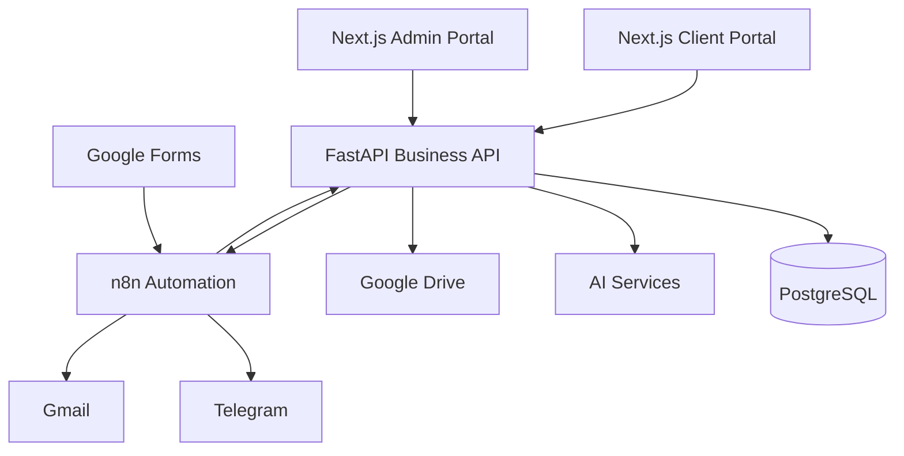
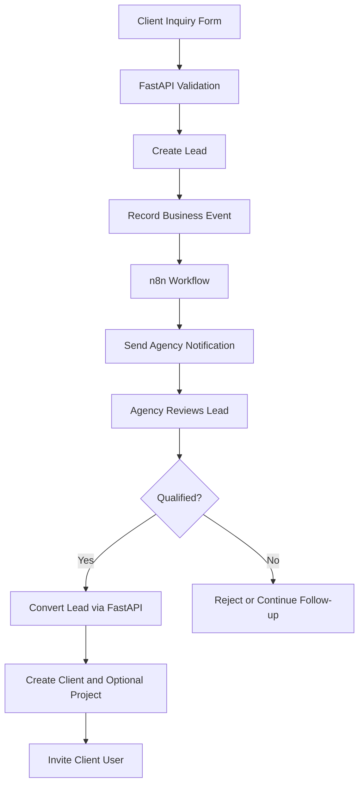
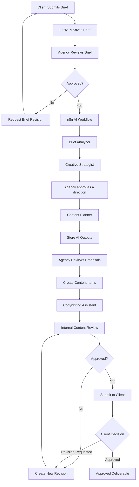
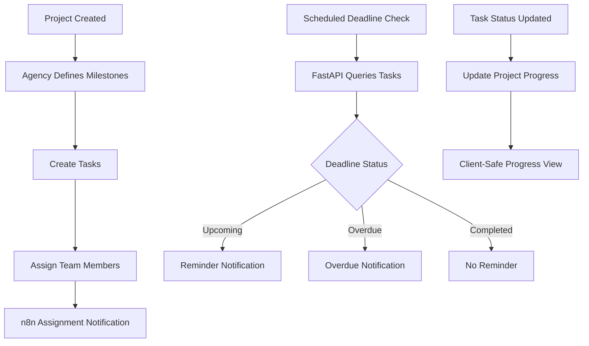
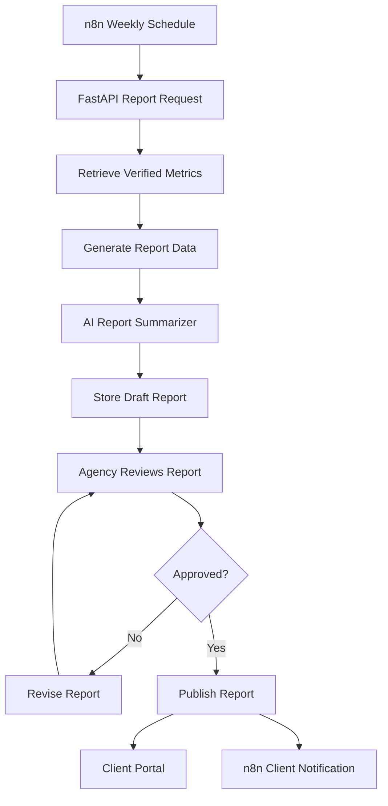

# CREATIVE OS — Workflow Automation Design

**Document:** Workflow Automation Design  
**Version:** 1.0  
**Status:** Proposed  
**Orchestration:** n8n  
**Backend:** FastAPI  
**Frontend:** Next.js  
**Database:** PostgreSQL

---

## 1. Purpose

This document defines the workflow automation architecture for CREATIVE OS.

The system contains four integrated business workflows:

- **Workflow A:** Client Acquisition & Onboarding
- **Workflow B:** AI Creative Intelligence & Content Production
- **Workflow C:** Project & Task Management
- **Workflow D:** Reporting & Performance Monitoring

Each workflow must support reliable automation, traceable execution, appropriate human intervention, and client data isolation.

The objective is to build a functional end-to-end agency operations platform, not a collection of disconnected n8n demonstrations.

## 2. Core Automation Principles

### 2.1 FastAPI owns business logic

FastAPI is responsible for:

- Authentication and authorization.
- Business state transitions.
- Database transactions.
- Resource ownership validation.
- AI generation requests.
- Content approval enforcement.
- Report publication.
- Audit logging.

n8n must not directly modify core PostgreSQL business tables.

### 2.2 n8n owns orchestration

n8n is responsible for:

- Receiving approved workflow events.
- Coordinating external integrations.
- Triggering authorized backend operations.
- Scheduling recurring processes.
- Sending notifications.
- Managing bounded retries.
- Recording workflow outcomes.

### 2.3 Human-in-the-loop

Human approval is required for:

- Lead conversion.
- Brief approval.
- Creative direction acceptance.
- Internal content approval.
- Client content approval.
- Client-facing report publication.

AI must not bypass these checkpoints.

### 2.4 Client isolation

Client users can only interact with authorized resources belonging to their client organization.

n8n must not trust client identifiers supplied in unverified webhook payloads.

All client ownership checks must be performed by FastAPI.

---

## 3. High-Level Workflow Architecture



All four workflows share the same backend, database, and authorization model.

## 4. Workflow Registry

| ID | Workflow | Primary trigger | Automation outcome |
|---|---|---|---|
| WF-A | Client Acquisition & Onboarding | Inquiry submitted | Lead created and agency notified |
| WF-B | AI Creative Intelligence | Brief approved or AI generation requested | Structured creative proposals generated |
| WF-C | Project & Task Management | Task/project event or scheduled check | Assignments and deadline notifications |
| WF-D | Reporting & Monitoring | Scheduled report or manual request | Draft reports and dashboard updates |

### Workflow ownership

Each workflow should have:

- A stable workflow identifier.
- A documented trigger.
- A version.
- A defined input schema.
- A defined output schema.
- A failure-handling strategy.
- A retry policy.
- An execution record.

---

# Part I — Workflow A: Client Acquisition & Onboarding

## 5. Business Objective

Automate the intake and initial management of prospective clients.

The workflow should:

1. Receive inquiries.
2. Validate submitted information.
3. Create leads.
4. Notify the agency.
5. Allow agency users to qualify leads.
6. Support lead conversion into clients.
7. Support client portal invitations.

Lead qualification and conversion remain human-controlled.

## 6. Workflow A — Primary Flow



### 6.1 Trigger

Primary trigger:

`lead.created`

Origin:
- Client Portal inquiry form.
- Google Forms integration.
- Manual agency entry.

### 6.2 n8n node sequence

Recommended n8n workflow:

1. **Webhook Trigger** — receive an authenticated lead-created event.
2. **Edit Fields / Set** — normalize event metadata.
3. **HTTP Request** — retrieve authorized lead notification details from FastAPI.
4. **IF** — verify notification eligibility.
5. **Telegram Node** — send an internal lead notification.
6. **Email Node** — optionally send an agency notification.
7. **HTTP Request** — report delivery outcome to FastAPI.

Node names may differ between installed n8n versions.

### 6.3 Example event

```json
{
  "event_id": "event-uuid",
  "event_type": "lead.created",
  "occurred_at": "2026-11-20T08:00:00Z",
  "resource": {
    "type": "lead",
    "id": "lead-uuid"
  },
  "workflow_version": "1.0"
}
```

Use minimal event payloads.

Do not include unnecessary personal information or confidential inquiry details in webhook events.

### 6.4 Agency notification

Example Telegram message:

```text
New Client Inquiry

Company: Example Brand
Service: Social Media Management
Status: New

Open CREATIVE OS Admin Portal to review.
```

Notifications should not expose sensitive information unnecessarily.

### 6.5 Human-controlled conversion

The agency reviews the lead through the Admin Portal.

If qualified:

`POST /api/v1/leads/{lead_id}/convert`

FastAPI performs the conversion transaction.

n8n must not directly create client records or change lead status in PostgreSQL.

### 6.6 Google Forms alternative input

Google Forms is an external intake demonstration.

Recommended approach:

Google Forms → Google Sheets response destination → n8n Google Sheets Trigger or polling → protected FastAPI integration endpoint.

Use the integration mechanism supported by the installed n8n version.

Every external submission must have a stable source submission identifier.

FastAPI must prevent duplicate lead creation when the same submission is processed more than once.

### 6.7 Failure handling

| Failure | Handling |
|---|---|
| Invalid inquiry | FastAPI rejects request |
| Duplicate external submission | Return existing result |
| Telegram failure | Record failure and retry notification |
| Gmail failure | Retry within configured limits |
| Lead conversion conflict | Reject duplicate conversion |
| Client invitation failure | Preserve client record and retry invitation |

A notification failure must not roll back a successfully created lead.

---

# Part II — Workflow B: AI Creative Intelligence & Content Production

## 7. Business Objective

Automate creative preparation while preserving agency and client approval.

This is the central AI workflow of CREATIVE OS.

It connects:

Client Brief → Brief Review → AI Analysis → Creative Direction → Content Plan → Copywriting → Internal Approval → Client Approval.

## 8. Workflow B — End-to-End Flow



## 9. Workflow B — Trigger and Execution

### 9.1 Trigger

Primary event:

`brief.approved`

Additional authorized triggers:
- Manual creative direction generation.
- Manual content plan generation.
- Copywriting generation.
- Revision generation.

### 9.2 Recommended n8n node sequence

1. **Webhook Trigger** — receive authenticated `brief.approved` event.
2. **HTTP Request** — retrieve authorized brief context from FastAPI.
3. **HTTP Request** — request brief analysis.
4. **Wait / Poll** — wait for asynchronous generation completion.
5. **IF** — verify analysis success.
6. **HTTP Request** — request creative direction generation.
7. **Wait / Poll** — wait for completion.
8. **IF** — verify creative direction success, notify reviewers and finish this run. An authorized agency user selects a direction in Creative Studio.
9. **Webhook / HTTP Request** — on creative_direction.approved start a run for the selected direction and request content plan generation.
10. **Wait / Poll** — wait for completion.
11. **IF** — verify content plan success.
12. **HTTP Request** — mark workflow execution complete.
13. **Telegram / Gmail** — notify agency reviewers.

The exact node arrangement may be simplified if the AI service internally coordinates multiple generation stages.

### 9.3 API interaction

Expected backend operations:

```text
POST /api/v1/internal/workflow-runs
POST /api/v1/internal/workflow-runs/{run_id}/generations
GET /api/v1/internal/workflow-runs/{run_id}/generations/{generation_id}
POST /api/v1/internal/workflow-runs/{run_id}/outcome
```

The backend must support authenticated service execution.

Internal workflow credentials must not impersonate arbitrary client users.

### 9.4 Sequential dependencies

Brief analysis must complete before dependent creative strategy generation.

Creative strategy must be available before the content planner uses it.

However, these stages must not automatically imply approval.

For the MVP, generated creative strategy and content plans may be stored as proposals awaiting agency review.

If a stage requires explicit human approval before the next stage, the workflow must stop and resume only after an authorized approval event.

### 9.5 AI generation failure

If generation fails:

1. Record the failed generation.
2. Record the workflow error.
3. Retry only eligible transient failures.
4. Stop dependent generation steps.
5. Notify the agency when appropriate.
6. Preserve all previously completed outputs.

Do not generate downstream content using missing or invalid upstream results.

## 10. Content Approval Automation

### 10.1 Internal approval

Agency users review generated content.

FastAPI records approval against the exact content revision.

### 10.2 Client review notification

When an approved revision is submitted to the client:

Event:

`content.client_review_requested`

n8n sends a notification containing a link to the authorized Client Portal page.

Do not attach confidential internal drafts.

### 10.3 Client approval

The client approves or requests revision through the Client Portal.

FastAPI records:
- Reviewer.
- Revision ID.
- Decision.
- Timestamp.
- Feedback.

Possible events:

- `content.client_approved`
- `content.revision_requested`

n8n may notify the agency team after either event.

### 10.4 Important restrictions

- AI cannot approve its own output.
- n8n cannot approve content on behalf of a human.
- Approval must reference the exact revision.
- Client approval does not trigger social media publication.
- No automatic publishing is included in the MVP.

---

# Part III — Workflow C: Project & Task Management

## 11. Business Objective

Coordinate project execution and task management.

The workflow should automate:
- Task assignment notifications.
- Deadline reminders.
- Overdue task detection.
- Milestone progress notifications.
- Project status monitoring.

Task creation and assignment are primarily deterministic operations.

## 12. Workflow C — Architecture



## 13. Task Assignment Workflow

### 13.1 Trigger

Event:

`task.assigned`

### 13.2 Node sequence

1. Webhook Trigger.
2. HTTP Request — retrieve authorized assignment details.
3. IF — verify assigned user and notification preferences.
4. Telegram or Gmail notification.
5. HTTP Request — report delivery status.

Example notification:

```text
New Task Assigned

Project: Summer Campaign
Task: Prepare Carousel Design
Due Date: 2026-12-05

Open CREATIVE OS to review.
```

### 13.3 Business rules

- Only authorized agency users can assign tasks.
- Task assignment must be persisted before notification.
- Notification failure must not undo the assignment.
- Duplicate events must not generate uncontrolled duplicate notifications.

## 14. Deadline Monitoring Workflow

### 14.1 Trigger

n8n Schedule Trigger.

Recommended MVP schedule:

Once daily at a configurable agency-local time.

The default agency timezone should be configurable, with `Asia/Jakarta` as an initial development setting.

### 14.2 Node sequence

1. Schedule Trigger.
2. HTTP Request — call protected deadline-check endpoint.
3. Receive eligible upcoming and overdue tasks.
4. Loop Over Items — process notification candidates.
5. IF — determine notification type.
6. Telegram / Gmail — send reminder.
7. HTTP Request — record delivery outcome.

### 14.3 Deadline rules

Suggested defaults:

| Condition | Action |
|---|---|
| Due within 24 hours | Upcoming deadline reminder |
| Due today | Due-today reminder |
| Past due and incomplete | Overdue notification |
| Completed | No reminder |
| Cancelled | No reminder |

These conditions must be implemented consistently using the configured timezone.

Avoid duplicate reminders within the same notification window.

### 14.4 Client-facing progress

Client users may view:
- Project status.
- Approved milestones.
- Overall progress.
- Upcoming deliverables.
- Content awaiting approval.

Client users must not automatically see:
- Internal task notes.
- Internal workload.
- Internal staffing details.
- Private agency comments.

Progress metrics should be calculated by FastAPI from authorized records.

---

# Part IV — Workflow D: Reporting & Performance Monitoring

## 15. Business Objective

Automate operational reporting for agency staff and clients.

The workflow should:
- Retrieve verified project metrics.
- Generate periodic report drafts.
- Produce AI-assisted summaries.
- Notify agency reviewers.
- Publish approved reports to clients.

## 16. Workflow D — Architecture



## 17. Scheduled Reporting

### 17.1 Trigger

n8n Schedule Trigger.

Recommended MVP schedule:

Weekly, at a configurable agency-local day and time.

### 17.2 Node sequence

1. Schedule Trigger.
2. HTTP Request — retrieve eligible reporting projects.
3. Loop Over Items — process each project.
4. HTTP Request — request report generation.
5. Wait / Poll — monitor report generation.
6. IF — check report status.
7. HTTP Request — record workflow outcome.
8. Telegram / Gmail — notify agency reviewer.

### 17.3 Reporting metrics

Verified metrics may include:
- Total tasks.
- Completed tasks.
- In-progress tasks.
- Overdue tasks.
- Milestones completed.
- Content drafts created.
- Content awaiting approval.
- Content approved.
- Project completion percentage.

All numeric metrics must be calculated by deterministic backend logic.

The LLM may summarize metrics but must not invent them.

### 17.4 Report publication

Reports are drafts by default.

An authorized agency user must review and publish the report.

Only published client-scoped reports are visible in the Client Portal.

Agency-wide reports must remain restricted to authorized agency roles.

### 17.5 Dashboard updates

Dashboards should retrieve current authorized data from FastAPI.

The MVP does not require n8n to push every dashboard update.

Use:
- Standard API fetching.
- Client-side cache invalidation.
- Refresh after relevant mutations.
- Optional periodic polling.

Real-time WebSockets are not required for the MVP.

---

# Part V — Shared Workflow Infrastructure

## 18. Reliable Event Delivery

A successful database transaction must not depend on immediate n8n availability.

Recommended approach: **Transactional Outbox Pattern**.

### 18.1 Outbox design

Add a supporting table:

`outbox_events`

Recommended fields:

| Column | Type | Purpose |
|---|---|---|
| id | UUID, PK | Event identifier |
| event_type | VARCHAR(100) | Event name |
| aggregate_type | VARCHAR(50) | Related entity type |
| aggregate_id | UUID | Related entity ID |
| payload | JSONB | Minimal event payload |
| status | VARCHAR(30) | Delivery state |
| attempts | INTEGER | Delivery attempts |
| next_attempt_at | TIMESTAMPTZ | Retry schedule |
| created_at | TIMESTAMPTZ | Creation time |
| delivered_at | TIMESTAMPTZ, nullable | Delivery time |

Allowed statuses:
- `pending`
- `processing`
- `delivered`
- `failed`

### 18.2 Delivery process

1. FastAPI performs the business transaction.
2. The transaction also creates an outbox event.
3. A dispatcher retrieves pending events.
4. The dispatcher sends authenticated events to n8n.
5. n8n acknowledges receipt.
6. The dispatcher records delivery status.
7. Failed deliveries are retried according to policy.

The dispatcher may be implemented using a lightweight background worker.

Do not depend on a request-scoped background task for durable event delivery.

### 18.3 Delivery semantics

Assume **at-least-once delivery**.

An event may be delivered more than once.

Consumers must therefore be idempotent.

Do not claim exactly-once execution across FastAPI, n8n, and external notification providers.

## 19. Idempotency and Duplicate Prevention

Every important workflow event should have a stable `event_id`.

n8n and FastAPI should use this identifier to detect duplicate processing.

Recommended supporting table:

`processed_events`

Fields:
- `id`
- `event_id`
- `consumer_name`
- `processed_at`
- `result_status`

Unique constraint:

`UNIQUE(event_id, consumer_name)`

Important:
- Duplicate event delivery must not create duplicate clients.
- Duplicate brief events must not create uncontrolled AI generations.
- Duplicate report triggers must not create duplicate reports for the same reporting period.
- Notification retries must not repeat business state transitions.

## 20. Workflow Execution Records

Use the existing `workflow_runs` table defined in the database specification.

Track:
- Workflow name.
- Workflow version.
- Trigger type.
- Related business entity.
- Start time.
- Completion time.
- Status.
- Error message.
- Execution metadata.

Where possible, associate the n8n execution ID with the application workflow run.

Do not store sensitive credentials in workflow metadata.

## 21. Retry Policy

Recommended initial retry behavior:

| Failure type | Retry? | Strategy |
|---|---|---|
| Temporary network failure | Yes | Exponential backoff |
| HTTP 429 | Yes | Respect retry guidance |
| HTTP 502/503 | Yes | Bounded retry |
| Invalid payload | No | Record failure |
| Authorization failure | No | Alert and investigate |
| Invalid business transition | No | Record conflict |
| AI schema failure | Limited | Controlled repair, then fail |
| Duplicate event | No new action | Return existing result |

Suggested initial maximum:

Three attempts for transient external failures.

This is a starting configuration, not a universal requirement.

## 22. Failure Recovery

A failed workflow should not corrupt completed business operations.

Examples:

**Lead notification failure**

The lead remains created.

The notification can be retried independently.

**AI generation failure**

The approved brief remains unchanged.

The generation is marked failed.

The agency can retry the generation.

**Client notification failure**

The content remains available in the Client Portal.

The notification can be retried.

**Report summarization failure**

Verified numeric metrics remain available.

The report may remain in a draft or failed-generation state.

The system must not fabricate a completed AI summary.

## 23. Integration Security

### 23.1 Service authentication

n8n must use dedicated service credentials when calling FastAPI.

The credentials must be:
- Stored securely.
- Scoped to required operations.
- Rotatable.
- Excluded from Git.
- Unavailable to browser clients.

### 23.2 Webhook authentication

Inbound webhook requests must be authenticated.

Possible methods:
- Signed payloads.
- HMAC signatures.
- Dedicated service tokens.

Use the signed webhook and scoped service-call contracts in §28.

### 23.3 External integrations

Google Forms:
- Validate source submissions.
- Use stable submission IDs.
- Reject malformed data.

Telegram:
- Store bot tokens securely.
- Restrict notification destinations.
- Avoid confidential payloads.

Gmail:
- Use approved authentication.
- Avoid exposing access tokens.
- Apply appropriate sending limits.

Google Drive:
- Access files through authorized backend operations.
- Do not expose unrestricted client files.

## 24. Workflow Monitoring

The Admin Portal should provide an automation monitoring view.

Minimum information:
- Workflow name.
- Trigger type.
- Related project or client.
- Start time.
- Completion time.
- Status.
- Failure reason.
- Retry eligibility.

Suggested statuses:
- Pending.
- Running.
- Completed.
- Failed.
- Cancelled.

Agency managers should be able to investigate failed executions.

Manual retry must be limited to eligible workflows and authorized users.

## 25. Workflow Testing

### Workflow A
- Valid inquiry creates one lead.
- Duplicate external submission does not create duplicate leads.
- Notification failure does not remove the lead.
- Lead conversion is transactional.
- Unauthorized conversion is rejected.

### Workflow B
- Unapproved briefs cannot trigger approved-brief generation.
- Invalid AI output is rejected.
- Duplicate events do not create uncontrolled generations.
- Content remains internal until approved.
- Client approval applies to the correct revision.
- Client cannot access another client's content.

### Workflow C
- Task assignment is persisted before notification.
- Completed tasks do not receive overdue reminders.
- Deadline reminders respect configured timezone.
- Duplicate reminders are prevented.
- Client users cannot access internal task details.

### Workflow D
- Report metrics match database values.
- Duplicate scheduled triggers do not create duplicate reports.
- AI summarization failure is recorded.
- Draft reports are not visible to clients.
- Client users cannot access agency-wide reports.

### Shared infrastructure
- Invalid webhook signatures are rejected.
- Outbox events survive temporary n8n unavailability.
- Failed deliveries are retried.
- Duplicate events are handled idempotently.
- Workflow logs do not expose secrets.

---

## 26. Recommended n8n Workflow Files

Store exportable n8n workflow definitions in the repository.

```text
automation/
├── README.md
├── n8n/
│   ├── wf_a_lead_intake.json
│   ├── wf_a_google_forms_intake.json
│   ├── wf_b_creative_generation.json
│   ├── wf_b_content_review_notification.json
│   ├── wf_c_task_assignment.json
│   ├── wf_c_deadline_monitor.json
│   ├── wf_d_weekly_reporting.json
│   └── wf_shared_error_handler.json
└── examples/
    ├── lead_created_event.json
    ├── brief_approved_event.json
    └── task_assigned_event.json
```

The four business workflows may be implemented using multiple smaller n8n workflow definitions.

This is preferable to building one enormous workflow containing every business process.

Exported workflow files must not contain real credentials or secrets.

## 27. Implementation Order

### Phase 1 — Automation Foundation

Implement:
- n8n local service.
- Service authentication.
- Workflow run tracking.
- Outbox events.
- Event dispatcher.
- Idempotency handling.
- Shared error handling.

### Phase 2 — Workflow A

Implement:
- Lead-created event.
- Internal notification.
- Google Forms alternative intake.
- Conversion-related notification.

### Phase 3 — Workflow B

Implement:
- Brief-approved event.
- AI generation orchestration.
- Generation status monitoring.
- Content review notification.
- Client approval notification.

### Phase 4 — Workflow C

Implement:
- Task assignment notification.
- Scheduled deadline monitor.
- Overdue reminders.
- Duplicate reminder prevention.

### Phase 5 — Workflow D

Implement:
- Weekly report schedule.
- Report generation trigger.
- Report completion monitoring.
- Agency review notification.
- Client publication notification.

---

## 28. Integration Contract Clarifications

The dispatcher sends events to n8n. The service calls FastAPI for all reads, writes and outcomes. API §6.2 defines those endpoints. Keep service credentials separate from browser sessions. Sign webhook requests using HMAC-SHA256 over the timestamp and raw request body, verify with a direction-specific secret and bounded clock skew, and deduplicate by stable event ID. Use dedicated scoped credentials for service API requests. Callbacks authenticate and link to a known run. The receiver acknowledges a trigger after durable acceptance. Subsequent step failure appears on the run even if outbox delivery succeeded.

| Workflow ID | Event or schedule | Authorized effect |
|---|---|---|
| WF-A | `lead.created` | Notify the agency after lead commit |
| WF-B | `brief.approved` | Start analysis for the approved snapshot, then directions after successful analysis |
| WF-B | `creative_direction.approved` | Plan from the selected direction on that snapshot |
| WF-B | `content.client_review_requested` | Notify the client of the released revision |
| WF-B | `content.client_approved`, `content.revision_requested` | Notify agency of the revision decision |
| WF-C | `task.assigned` or daily deadline schedule | Notify eligible assignees once per action and window |
| WF-D | Weekly period or manual generation | Generate or retrieve the project-period report for agency review |
| WF-D | `report.published` | Notify the owning client of a human-published report |

Use the outbox UUID as event_id. Pin workflow_version on each run. Scheduled keys include workflow ID and the configured agency-local window. Store UTC timestamps and evaluate date-only deadlines against the agency-local date. Due today takes precedence over upcoming (tomorrow), followed by overdue for earlier dates. Exclude completed and cancelled tasks.

Database §§4.4–4.7 specify the durable records, notification uniqueness, service identity and publication lifecycle. A duplicate resumes outstanding steps or returns their recorded results. For an ambiguous external delivery, use provider reconciliation or a recorded manual decision before resending.

---

## 29. MVP Acceptance Criteria

Workflow automation is ready when:

1. n8n runs in the local Docker Compose environment.
2. FastAPI can reliably dispatch business events.
3. Workflow executions are recorded.
4. Duplicate events are handled safely.
5. Workflow A creates leads and notifies agency users.
6. Google Forms can act as an alternative inquiry source.
7. Workflow B can coordinate AI creative generation.
8. Generated content remains subject to human approval.
9. Workflow C sends task assignment notifications.
10. Deadline monitoring identifies eligible tasks.
11. Workflow D generates draft weekly reports.
12. Reports require human publication.
13. Failed workflows are visible to authorized agency users.
14. Transient failures can be retried safely.
15. Client data isolation is preserved throughout automation.

---

## 30. Instructions for Codex

Treat this document as the source of truth for workflow orchestration.

Before implementation:

1. Read `AGENTS.md`.
2. Read all existing project specifications.
3. Identify inconsistencies between workflow events, API endpoints, and database entities.
4. Propose required schema and API amendments.
5. Define the workflow execution and retry strategy.
6. Confirm the local n8n integration architecture.
7. Implement the automation foundation before building business workflows.

Implementation requirements:

- Use n8n for orchestration.
- Use FastAPI for business logic.
- Do not write directly to business tables from n8n.
- Use authenticated internal APIs.
- Use stable event identifiers.
- Implement idempotency.
- Record workflow executions.
- Handle external service failures.
- Keep credentials outside the repository.
- Export workflow definitions as version-controlled JSON files.
- Add tests for duplicate events, authorization, and failure recovery.

Do not introduce unnecessary distributed infrastructure for the MVP.

**The goal is a reliable, demonstrable automation platform with four integrated business workflows and clear human accountability.**