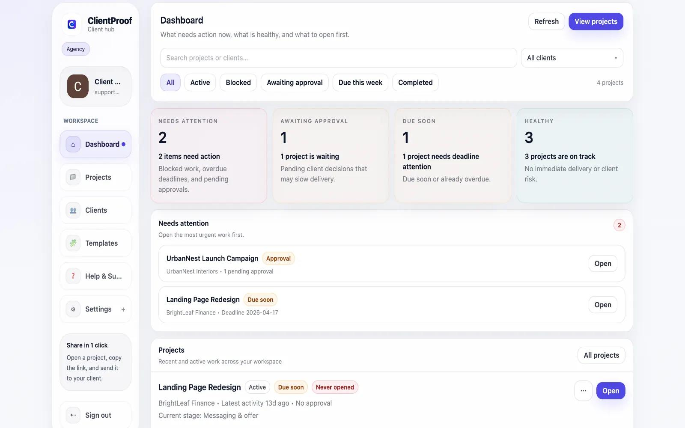
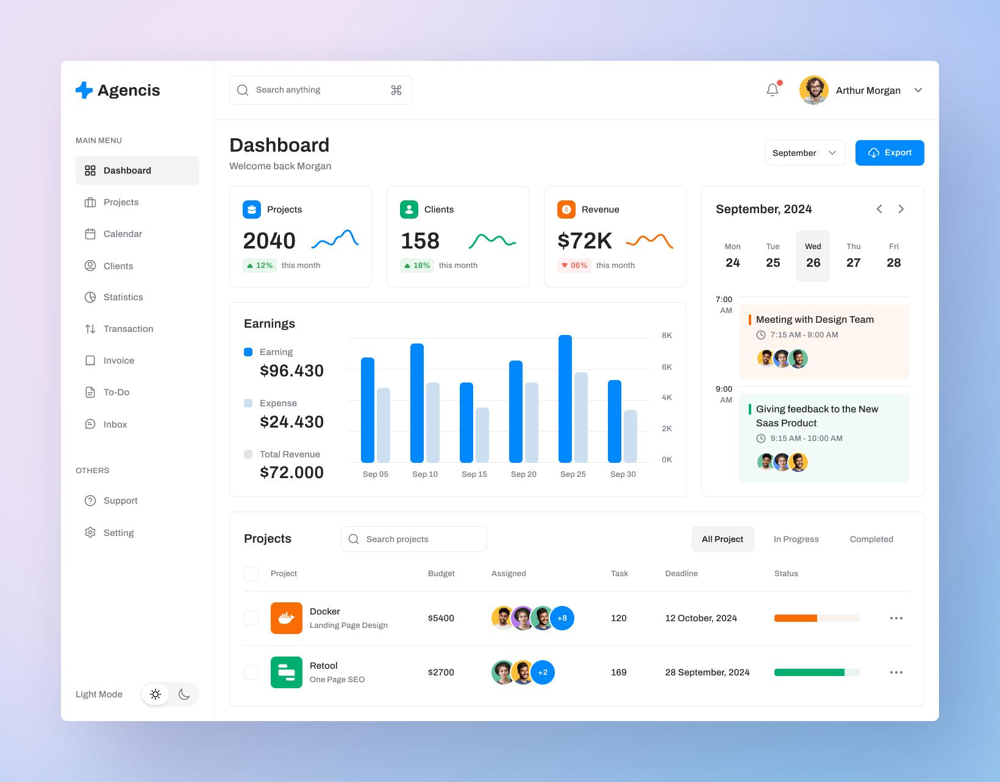

# CREATIVE OS — Frontend & UX Design Specification

**Document:** Frontend & UX Design  
**Version:** 1.0  
**Status:** Proposed  
**Frontend:** Next.js + TypeScript  
**Styling:** Tailwind CSS  
**UI Components:** shadcn/ui  
**Design Direction:** Premium Creative SaaS

---

## 1. Product Experience Vision

CREATIVE OS is an AI-powered creative agency operations platform with two connected experiences:

1. **Client Portal** — a streamlined workspace where clients submit briefs, track projects, review creative work, provide feedback, and access reports.
2. **Admin Portal** — an operational command center where agency teams manage leads, clients, projects, AI generation, tasks, approvals, automation, and reporting.

Both portals must be implemented within a single Next.js application, sharing a consistent design system and authentication infrastructure.

The product should feel polished, trustworthy, modern, and intuitive.

It should not resemble an unfinished developer dashboard or a collection of disconnected forms.

## 2. Design Principles

### 2.1 Clarity before complexity

Prioritize:
- Clear navigation.
- Understandable workflow states.
- Strong information hierarchy.
- Actionable dashboards.
- Consistent terminology.
- Minimal unnecessary clicks.

Avoid:
- Excessive dashboard widgets.
- Overwhelming navigation.
- Decorative animations that interfere with usability.
- Technical jargon in client-facing interfaces.

### 2.2 Distinct portal experiences

The Client Portal should prioritize:
- Ease of use.
- Transparency.
- Collaboration.
- Review and approval.
- Confidence in project progress.

The Admin Portal should prioritize:
- Operational efficiency.
- Visibility across clients.
- Task management.
- AI-assisted creative production.
- Workflow monitoring.

### 2.3 Professional visual quality

The design should be suitable for a production-oriented portfolio.

Use:
- Refined typography.
- Spacious layouts.
- Consistent spacing.
- Subtle borders.
- Clear visual hierarchy.
- High-quality empty states.
- Meaningful status indicators.
- Responsive layouts.

Avoid default-looking dashboards with excessive cards, bright gradients, and unrelated decorative elements.

### 2.4 Accessibility

Target WCAG 2.2 AA where practical.

Requirements:
- Keyboard navigation.
- Visible focus indicators.
- Sufficient color contrast.
- Semantic HTML.
- Accessible forms.
- Clear error messages.
- Screen-reader-friendly controls.
- Reduced-motion support.

Color must not be the only indicator of workflow status.

---

# Part I — Visual Design System

## 3. Design Direction

**Theme:** Contemporary Creative Operations Platform

Visual characteristics:
- Neutral, sophisticated foundation.
- Restrained accent color.
- Editorial-style typography.
- Clean SaaS layout.
- Subtle depth and layering.
- Data-dense admin views without visual clutter.
- Calm and approachable client-facing pages.

The platform should balance creative agency personality with enterprise software usability.

## 4. Color System

Recommended initial palette:

| Token | Light theme | Usage |
|---|---|---|
| Background | `#F8F9FB` | Main page background |
| Surface | `#FFFFFF` | Cards and panels |
| Foreground | `#17191F` | Primary text |
| Muted foreground | `#667085` | Secondary text |
| Border | `#E5E7EB` | Dividers and borders |
| Primary | `#4F46E5` | Primary actions |
| Primary hover | `#4338CA` | Hover state |
| Success | `#15803D` | Completed and approved |
| Warning | `#B45309` | Attention required |
| Destructive | `#B42318` | Errors and destructive actions |

Use semantic Tailwind/shadcn theme tokens rather than hardcoding colors across individual components.

Support light mode initially.

Dark mode is optional and should not delay the MVP.

## 5. Typography

Recommended:
- **Inter** for interface text.
- A refined display font may be used sparingly for marketing headings.

Suggested hierarchy:

| Element | Size | Weight |
|---|---|---|
| Page heading | 28–32px | Semibold |
| Section heading | 20–24px | Semibold |
| Card heading | 16–18px | Semibold |
| Body | 14–16px | Regular |
| Supporting text | 12–14px | Regular |
| KPI value | 28–36px | Semibold |

Typography must remain consistent across both portals.

## 6. Spacing and Layout

Use a consistent spacing scale based on Tailwind utilities.

Recommended:
- Desktop sidebar: approximately 240–260px.
- Main content max-width: approximately 1440px where appropriate.
- Page padding: 24–32px on desktop.
- Card padding: 20–24px.
- Border radius: 10–14px.
- Standard component gap: 12–24px.

Avoid excessively wide forms.

Use narrower content containers for:
- Brief submission.
- Client feedback.
- Profile settings.
- Content review.

## 7. Core UI Components

Use shadcn/ui and accessible primitives.

Required component categories:

**Navigation**
- Sidebar.
- Top navigation.
- Breadcrumbs.
- User menu.
- Mobile navigation.

**Data display**
- Cards.
- Tables.
- Tabs.
- Badges.
- Progress indicators.
- Charts.
- Activity timeline.

**Inputs**
- Text inputs.
- Textareas.
- Select menus.
- Date pickers.
- Checkboxes.
- File uploads.

**Feedback**
- Toast notifications.
- Confirmation dialogs.
- Loading skeletons.
- Empty states.
- Error states.

**Creative workflow**
- Content preview.
- Revision selector.
- Approval panel.
- Feedback thread.
- AI generation status.
- Generation result cards.

Do not create custom components when an accessible existing component is sufficient.

---

# Part II — Application Structure

## 8. Route Architecture

Use Next.js App Router.

Recommended structure:

```text
frontend/
├── app/
│   ├── (public)/
│   │   ├── page.tsx
│   │   └── inquiry/
│   │       └── page.tsx
│   ├── (auth)/
│   │   ├── login/
│   │   │   └── page.tsx
│   │   └── forgot-password/
│   │       └── page.tsx
│   ├── (client)/
│   │   └── client/
│   │       ├── layout.tsx
│   │       ├── dashboard/
│   │       │   └── page.tsx
│   │       ├── projects/
│   │       │   ├── page.tsx
│   │       │   └── [projectId]/
│   │       │       └── page.tsx
│   │       ├── briefs/
│   │       │   ├── page.tsx
│   │       │   └── new/
│   │       │       └── page.tsx
│   │       ├── approvals/
│   │       │   ├── page.tsx
│   │       │   └── [contentId]/
│   │       │       └── page.tsx
│   │       ├── reports/
│   │       │   └── page.tsx
│   │       └── files/
│   │           └── page.tsx
│   ├── (admin)/
│   │   └── admin/
│   │       ├── layout.tsx
│   │       ├── dashboard/
│   │       │   └── page.tsx
│   │       ├── leads/
│   │       │   └── page.tsx
│   │       ├── clients/
│   │       │   └── page.tsx
│   │       ├── projects/
│   │       │   └── page.tsx
│   │       ├── tasks/
│   │       │   └── page.tsx
│   │       ├── creative-studio/
│   │       │   └── page.tsx
│   │       ├── approvals/
│   │       │   └── page.tsx
│   │       ├── automation/
│   │       │   └── page.tsx
│   │       ├── analytics/
│   │       │   └── page.tsx
│   │       └── settings/
│   │           └── page.tsx
│   ├── layout.tsx
│   └── globals.css
├── components/
│   ├── ui/
│   ├── layout/
│   ├── dashboard/
│   ├── projects/
│   ├── creative/
│   ├── approvals/
│   └── shared/
├── features/
├── hooks/
├── lib/
│   ├── api/
│   ├── auth/
│   ├── utils/
│   └── validations/
├── types/
└── public/
```

This structure is a recommended starting point.

Codex may refine feature organization as long as route boundaries, authorization, and maintainability are preserved.

## 9. Navigation Architecture

### Client Portal

Primary navigation:
- Dashboard.
- Projects.
- Creative Briefs.
- Approvals.
- Reports.
- Files.

Secondary navigation:
- Notifications.
- Profile.
- Sign out.

### Admin Portal

Primary navigation:
- Overview.
- Leads.
- Clients.
- Projects.
- Tasks.
- Creative Studio.
- Approvals.
- Automation.
- Analytics.

Secondary navigation:
- Notifications.
- Settings.
- Profile.
- Sign out.

Navigation items must be filtered according to user permissions.

However, hiding navigation links is not a substitute for backend authorization.

### Portal permission matrix

Render the controls below from FastAPI’s permitted actions for the selected portal, target and project. “Delegated” means an active grant on the displayed project. The review buttons also require an open request for the displayed revision.

| Operation | Admin | Manager | Team Member | Client Admin | Client Member | Delegated |
|---|---|---|---|---|---|---|
| Manage Team Member membership | Allowed | Team targets only | Denied | Denied | Denied | Denied |
| Manage Admin or Manager roles | Allowed | Denied | Denied | Denied | Denied | Denied |
| Manage authentication or security settings | Allowed | Denied | Denied | Denied | Denied | Denied |
| Manage agency-wide project assignments, tasks and workflows | Allowed | Allowed | Denied | Denied | Denied | Denied |
| Manage agency operational settings | Allowed | Allowed | Denied | Denied | Denied | Denied |
| Manage client approval delegations | Denied | Denied | Denied | Allowed | Denied | Denied |
| Comment as client on released revision | Denied | Denied | Denied | Allowed | Allowed | Allowed |
| Approve submitted revision as client | Denied | Denied | Denied | Allowed | Denied | Allowed |
| Request revision as client | Denied | Denied | Denied | Allowed | Denied | Allowed |

In agency Settings, team lifecycle controls operate on the selected agency membership. Managers get project assignments, tasks, workflows and operational settings. Hide role controls for elevated targets and self-management, and list security settings only for Admins. Surface a last-Admin rejection without applying an optimistic update.

In Client Project details, show grant/revoke controls to the owning client_admin. Display the project and eligible client member together. In review detail, keep feedback available to read-authorized members. Show each binding action only when FastAPI permits it. After revocation, a stale session or a competing decision, refresh the exact review and permissions on 403 or 409. Delegates have no client role or delegation controls.

---

# Part III — Client Portal UX

## 10. Client Dashboard

Route:

`/client/dashboard`

### Purpose

Give clients a clear overview of their active work and pending actions.

### Page sections

**Header**
- Welcome message.
- Client organization name.
- Current date.
- Primary action: Submit Brief.

**Summary**
- Active projects.
- Pending approvals.
- Upcoming milestones.
- Recently completed deliverables.

**Project overview**
- Project name.
- Status.
- Progress.
- Next milestone.
- Link to project details.

**Pending approvals**
- Content title.
- Project.
- Review status.
- Action: Review Content.

**Recent activity**
- Brief submitted.
- Content ready for review.
- Project milestone completed.
- Report published.

### UX requirements

- Prioritize actions requiring client attention.
- Use understandable status labels.
- Do not expose internal agency task details.
- Display useful empty states for new clients.

## 11. Client Projects

Routes:

`/client/projects`

`/client/projects/[projectId]`

### Project list

Display:
- Project name.
- Service type.
- Status.
- Progress.
- Target completion date.
- Next milestone.

### Project detail

Suggested tabs:
- Overview.
- Timeline.
- Deliverables.
- Briefs.
- Reports.

The overview should show:
- Project objective.
- Current phase.
- Progress indicator.
- Upcoming milestones.
- Deliverables awaiting approval.

### Project progress

Project progress must originate from FastAPI.

Do not calculate progress independently from incomplete frontend data.

## 12. Creative Brief Submission

Route:

`/client/briefs/new`

### UX objective

Make it easy for a nontechnical client to communicate creative requirements.

Use a guided form.

Suggested sections:

**Step 1 — Project Context**
- Select project.
- Brief title.
- Campaign objective.

**Step 2 — Audience & Messaging**
- Target audience.
- Key message.
- Tone of voice.

**Step 3 — Content Requirements**
- Content type.
- Preferred channels.
- Number of requested content items.
- Target timeline.

**Step 4 — References & Restrictions**
- Reference links.
- Brand guidelines.
- Supporting files.
- Content restrictions.

**Step 5 — Review & Submit**
- Summary of entered information.
- Validation.
- Submit action.

### Form behavior

- Validate required fields.
- Show field-specific errors.
- Prevent accidental duplicate submission.
- Support draft saving where backend functionality exists.
- Confirm successful submission.
- Display submission status.

Do not imply autosave if it has not been implemented.

## 13. Client Content Approval

Routes:

`/client/approvals`

`/client/approvals/[contentId]`

### Approval list

Display:
- Content title.
- Project.
- Content type.
- Submitted revision.
- Submission date.
- Status.
- Review action.

### Approval detail

Recommended layout:

**Main panel**
- Content preview.
- Caption or copy.
- Visual direction.
- Supporting files.
- Revision number.

**Side panel**
- Approval status.
- Feedback history.
- Comment input.
- Approve button.
- Request Revision button.

### Approval UX rules

- Clearly display the exact revision being reviewed.
- Show confirmation before final approval.
- Require meaningful feedback when requesting a revision.
- Prevent approval of outdated or unavailable revisions.
- Display successful decisions only after backend confirmation.
- Make historical revisions distinguishable from the active review revision.

### Approval states

- Awaiting review.
- Approved.
- Revision requested.
- Rejected.
- Superseded.

Map pending to Awaiting review and superseded to Superseded. Display the active client-stage decision and the released revision returned by FastAPI. Rejected is displayable only when the backend releases such a decision. Authorized signers can approve or request revision. Other eligible readers can comment. A stale decision refreshes the review. See API §5.8.

## 14. Client Reports

Route:

`/client/reports`

### Page content

- Reporting period.
- Project name.
- Project status.
- Completed work.
- Pending work.
- Milestone progress.
- AI-assisted narrative summary.
- Download action where available.

Only published client reports may be displayed.

Do not show draft reports or agency-wide operational analytics.

## 15. Client Files

Route:

`/client/files`

Display authorized:
- Brand guidelines.
- Brief attachments.
- Creative deliverables.
- Published report exports.

Each file should show:
- File name.
- Type.
- Related project.
- Upload date.
- Download action.

All downloads must pass backend authorization.

---

# Part IV — Admin Portal UX

## 16. Admin Dashboard

Route:

`/admin/dashboard`

### Purpose

Provide an agency-wide operational overview.

### Key metrics

- Active clients.
- Active projects.
- Open tasks.
- Overdue tasks.
- Pending approvals.
- New leads.
- Failed workflows.

### Dashboard sections

**KPI overview**
- Compact metric cards.
- Comparison indicators only when supported by actual data.

**Project health**
- Project status.
- Upcoming deadlines.
- Blocked milestones.

**Team workload**
- Tasks assigned by team member.
- Overdue work.
- Upcoming deadlines.

**Creative pipeline**
- Briefs awaiting review.
- AI-generated drafts.
- Internal approvals pending.
- Client approvals pending.

**Automation health**
- Recent workflow runs.
- Failed executions.
- Retry eligibility.

Avoid displaying too many charts without clear decision-making value.

## 17. Lead Management

Route:

`/admin/leads`

### Required features

- Lead table.
- Search.
- Status filtering.
- Lead details.
- Assignment.
- Status updates.
- Convert to Client action.
- Rejection action.

### Lead detail view

Display:
- Company information.
- Contact information.
- Inquiry details.
- Lead source.
- Assigned team member.
- Status.
- Internal notes.
- Activity history.

Lead conversion should use a confirmation dialog.

## 18. Client Management

Route:

`/admin/clients`

### Required features

- Client directory.
- Client profile.
- Active projects.
- Client members.
- Brand guidelines.
- Client status.
- Invitation management.

Client details should be organized using tabs rather than one oversized page.

Suggested tabs:
- Overview.
- Projects.
- Brand Context.
- Members.
- Files.
- Activity.

## 19. Project Management

Route:

`/admin/projects`

### Required features

- Project list.
- Search and filtering.
- Project creation.
- Project detail.
- Project team.
- Milestones.
- Tasks.
- Progress tracking.

Recommended project detail tabs:
- Overview.
- Tasks.
- Milestones.
- Creative.
- Team.
- Activity.

### Project status visualization

Use:
- Clear status labels.
- Progress bars.
- Deadline indicators.
- Milestone timeline.

Avoid complex Gantt charts in the initial MVP.

## 20. Task Management

Route:

`/admin/tasks`

### Required views

**Table view**
- Task title.
- Project.
- Assignee.
- Priority.
- Status.
- Due date.

**Board view**
- To Do.
- In Progress.
- In Review.
- Completed.
- Blocked.

A simple Kanban board may be implemented if it does not delay core functionality.

### Task interactions

- Create task.
- Edit task.
- Assign team member.
- Update status.
- Change deadline.
- Mark completed.

Use optimistic updates only when rollback and error handling are implemented correctly.

## 21. Creative Studio

Route:

`/admin/creative-studio`

This is the primary AI workspace.

### UX objective

Allow agency users to transform client briefs into structured creative proposals and reviewable content.

### Recommended layout

**Left panel — Context**
- Client.
- Project.
- Selected brief.
- Brand guidelines.
- Creative constraints.

**Center panel — AI Workspace**
- Brief analysis.
- Creative directions.
- Content plans.
- Generated copy.
- Generation actions.

**Right panel — Review & Actions**
- Generation status.
- Validation state.
- Selected proposal.
- Save as content.
- Create revision.
- Submit for internal review.

On smaller screens, use tabs or stacked sections rather than forcing three narrow columns.

### AI generation UX

The interface should show:
- Generation type.
- Current status.
- Model information where appropriate.
- Generated output.
- Validation errors.
- Retry action.
- Save or accept action.

Poll the returned generation ID until completed, failed or cancelled. Render the validated schema in AI §5. The agency approves a direction before requesting its plan, then selects plan items and saves draft content. Use the proposal IDs and actions in API §5.7. Stop polling terminal jobs.

### Generated proposal cards

Each proposal should include:
- Title.
- Creative rationale.
- Target channel.
- Content format.
- Key message.
- Visual direction.

Allow agency users to select a proposal before creating a content item.

### Content editor

The editor should support:
- Editing copy.
- Reviewing structured fields.
- Saving a new revision.
- Comparing revisions.
- Requesting regeneration.
- Internal approval.

The MVP does not require a full visual design editor comparable to Canva or Figma.

## 22. Admin Approvals

Route:

`/admin/approvals`

### Required features

- Internal review queue.
- Client review queue.
- Approval status filtering.
- Revision history.
- Feedback history.
- Approval decisions.

### Review interface

Show:
- Source brief.
- Generated content.
- Current revision.
- Previous revision where applicable.
- Internal comments.
- Client feedback.
- Approval actions.

The approval interface must clearly distinguish internal approval from client approval.

## 23. Automation Monitoring

Route:

`/admin/automation`

### Required features

- Workflow list.
- Recent executions.
- Execution status.
- Trigger type.
- Related business entity.
- Error message.
- Retry action where permitted.

### Recommended sections

**Workflow health**
- Successful runs.
- Failed runs.
- Running workflows.

**Execution history**
- Workflow name.
- Trigger.
- Start time.
- Duration.
- Status.

**Execution detail**
- Related entity.
- Execution metadata.
- Error classification.
- Retry eligibility.

Do not expose webhook secrets, API keys, or confidential raw payloads.

## 24. Agency Analytics

Route:

`/admin/analytics`

### Purpose

Show operational performance.

Initial metrics:
- Project completion.
- Task completion.
- Overdue tasks.
- Lead conversion.
- Content approval volume.
- AI generation success rate.
- Workflow success rate.

### Charts

Use a lightweight charting library compatible with Next.js.

Recommended:
- Recharts.

Charts should be readable, responsive, and based on actual backend data.

Do not fabricate performance trends.

Use clearly labeled synthetic demonstration data only in explicitly designated demo mode.

---

# Part V — Interaction Patterns

## 25. Loading States

Every data-dependent page should provide appropriate loading feedback.

Use:
- Skeleton cards.
- Skeleton tables.
- Button loading states.
- Generation progress indicators.

Avoid indefinite spinners without explanation.

For asynchronous AI generation, show the actual backend status rather than simulated progress percentages.

## 26. Empty States

Examples:

**No projects**

"Your projects will appear here once your agency creates them."

**No pending approvals**

"You're all caught up. There are no deliverables waiting for your review."

**No AI generations**

"Select an approved brief to generate your first creative direction."

Empty states should provide a useful next action when the user has permission to perform it.

## 27. Error States

Errors should be understandable.

Examples:
- Unable to load projects.
- Brief submission failed.
- AI generation could not be completed.
- You do not have permission to access this resource.
- This revision is no longer available for approval.

Do not display raw backend exceptions or stack traces.

## 28. Confirmation Dialogs

Use confirmation dialogs for:
- Lead conversion.
- Client archiving.
- Project archiving.
- Content approval.
- Content rejection.
- Report publication.
- Destructive file actions.

Avoid unnecessary confirmation dialogs for routine navigation.

## 29. Notifications

The frontend should support in-app notifications.

Required:
- Notification list.
- Unread indicator.
- Mark as read.
- Link to related resource.

Do not assume a notification was delivered through Telegram or Gmail simply because it exists in the application.

## 30. Responsive Design

### Desktop

Primary target for agency operations.

Support:
- Sidebar navigation.
- Tables.
- Multi-panel creative workspace.
- Dashboard grids.

### Tablet

Support:
- Collapsible sidebar.
- Responsive cards.
- Simplified table layouts.
- Stacked creative panels.

### Mobile

Prioritize:
- Client brief submission.
- Project overview.
- Content review.
- Approval actions.
- Notifications.

The Admin Portal must remain usable on mobile, but advanced data-dense workflows may be optimized for desktop.

## 31. Accessibility Requirements

- All interactive elements must be keyboard accessible.
- Inputs must have labels.
- Errors must be associated with relevant fields.
- Dialogs must manage focus correctly.
- Status indicators must include text.
- Tables must use accessible headers.
- Interactive controls must have appropriate accessible names.
- Motion should respect reduced-motion preferences.

---

# Part VI — Frontend Engineering

## 32. Data Fetching

Use a consistent data-fetching strategy.

Recommended:
- Next.js Server Components for suitable initial page data.
- Client Components for interactive workflows.
- TanStack Query for client-side server-state management where beneficial.
- Typed API client functions.
- Centralized error handling.

Avoid duplicating API request logic across pages.

## 33. Authentication Integration

The frontend must:
- Respect authenticated sessions.
- Protect portal routes.
- Redirect unauthenticated users.
- Render navigation according to permissions.
- Handle expired sessions.
- Prevent accidental exposure of sensitive server data.

FastAPI remains the authority for authorization. Use the scoped collection APIs in API §5 for portal-wide lists. Key cached data by identity, portal and client context. Clear scoped data on logout and membership changes. Use invitation redemption for onboarding and the reset-token form for password recovery.

Next.js middleware or route guards provide additional UX protection, not the primary security boundary.

## 34. Form Validation

Recommended:
- React Hook Form.
- Zod.

Validation must exist on both frontend and backend.

Frontend validation improves usability.

Backend validation protects data integrity.

## 35. State Management

Prefer:
- Local React state for component interactions.
- TanStack Query for server state.
- URL search parameters for shareable filters.
- React Context only for limited cross-component state.

Avoid introducing a large global state management library without a clear need.

## 36. Component Architecture

Recommended feature-based organization:

```text
components/
├── ui/
├── layout/
│   ├── app-sidebar.tsx
│   ├── topbar.tsx
│   └── breadcrumbs.tsx
├── dashboard/
│   ├── metric-card.tsx
│   └── activity-feed.tsx
├── projects/
│   ├── project-card.tsx
│   ├── project-progress.tsx
│   └── milestone-timeline.tsx
├── creative/
│   ├── brief-form.tsx
│   ├── generation-panel.tsx
│   ├── creative-proposal-card.tsx
│   └── content-editor.tsx
├── approvals/
│   ├── approval-panel.tsx
│   ├── revision-selector.tsx
│   └── feedback-thread.tsx
└── shared/
    ├── empty-state.tsx
    ├── error-state.tsx
    └── status-badge.tsx
```

Components should remain reusable without becoming unnecessarily generic.

## 37. Frontend Security

- Do not store secrets in frontend code.
- Do not expose internal service tokens.
- Do not trust client-supplied ownership fields.
- Do not expose confidential internal data through serialized server responses.
- Use safe rendering for user-generated text.
- Sanitize or safely render rich text where supported.
- Prevent unsafe file handling.
- Respect backend authorization decisions.

## 38. Performance

Recommended:
- Lazy-load heavy components.
- Paginate large tables.
- Avoid unnecessary client-side JavaScript.
- Optimize image loading.
- Cache appropriate server-state queries.
- Invalidate caches after mutations.
- Avoid repeatedly polling completed AI generations.

Do not optimize prematurely at the expense of correctness.

---

# Part VII — MVP Page Prioritization

## 39. Priority 1 — Core Journey

Implement first:
- Public inquiry.
- Login.
- Client dashboard.
- Admin dashboard.
- Lead management.
- Client management.
- Project management.
- Brief submission.
- Creative Studio.
- Internal content review.
- Client approval.

These pages must support the end-to-end MVP demonstration.

## 40. Priority 2 — Operational Completion

Implement:
- Task management.
- Milestones.
- File management.
- Notifications.
- Automation monitoring.
- Client reports.
- Agency analytics.

## 41. Priority 3 — Enhancements

Potential later improvements:
- Advanced Kanban interactions.
- Rich content previews.
- More sophisticated analytics.
- Dark mode.
- Advanced search.
- Real-time collaboration.
- Customizable dashboards.

Do not allow these enhancements to delay the core MVP.

---

## 42. UX Acceptance Criteria

The frontend is ready when:

1. Client and Admin Portals use one coherent design system.
2. Both portals have distinct navigation and permissions.
3. Client users can submit inquiries and briefs.
4. Agency users can manage leads and projects.
5. Agency users can generate and review AI proposals.
6. Content approval is revision-specific.
7. Clients can review and approve authorized deliverables.
8. Project progress is visible without exposing internal details.
9. Reports are accessible only to authorized users.
10. Automation failures are visible to agency managers.
11. Loading, empty, and error states are implemented.
12. Forms provide meaningful validation.
13. Pages are responsive.
14. Critical interactions are keyboard accessible.
15. No Streamlit interface is used.

---

## 43. Instructions for Codex

Treat this document as the frontend design source of truth.

Before implementation:

1. Read `AGENTS.md`.
2. Read the PRD, architecture, database, API, AI, and workflow specifications.
3. Review the required routes.
4. Define the shared design tokens.
5. Propose the reusable component structure.
6. Build the application shell and authentication flow first.
7. Implement the end-to-end user journey incrementally.

Implementation requirements:

- Use Next.js App Router.
- Use TypeScript.
- Use Tailwind CSS.
- Use shadcn/ui.
- Build one application with Client and Admin Portals.
- Use accessible UI components.
- Integrate with FastAPI through typed API clients.
- Preserve backend authorization boundaries.
- Implement responsive layouts.
- Include loading, empty, and error states.
- Avoid placeholder functionality disguised as completed features.
- Do not use Streamlit.

**The frontend should communicate the quality of a professional SaaS product while remaining practical to implement and maintain.**

 